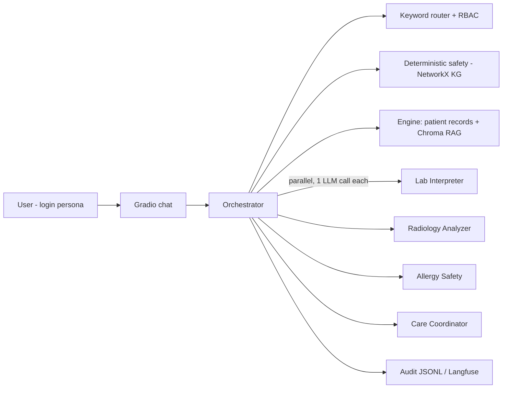

# ClinicalChat

ClinicalChat is a simple, role-aware **multi-agent clinical chatbot**, built for the *AI-Driven Multi-Role Clinical Intelligence System* problem statement.

You ask a question in plain English. ClinicalChat:

1. Routes it to the right specialist agents.
2. Checks what your role is allowed to see.
3. Runs the deterministic allergy and drug safety checks first.
4. Answers in the style your role needs:
   - **patient:** simple language
   - **clinician:** full technical detail
   - **radiologist:** imaging-focused
   - **coordinator:** care coordination

While it works, the chat shows a live **Agent activity** panel: understanding the question → gathering records → each specialist analysing → done.

**Which agent answered?** Three cues show this:
- An **agent strip** above the chat has one tile per agent. Each tile shows its state: Ready, Selected, Working…, Answered · time, cached answer, Requested · not permitted, or Not for your role.
- Each question gets a "🧭 Routed to **<agent>** · Patient: **<name>**" line.
- Every answer is headed with the agent's name.

When a question names a patient, the patient card on the left switches to that patient.

## Features

| Requirement | Implementation |
|---|---|
| Lab Interpreter (CBC, LFT, KFT, thyroid…) | `agents.py` (`LabOutput`). Values are flagged against the printed reference ranges by code before the LLM sees them. |
| Radiology Analyzer (X-ray, CT, MRI, US) | `agents.py` (`RadiologyOutput`): impression, differential diagnosis and critical findings. |
| Allergy Safety (severity, cross-reactivity, emergency) | NetworkX knowledge graph (`knowledge_graph.py`, `kg_ontology.py`) plus `AllergyOutput`. |
| Care coordination / handoff | Care Coordinator agent (`CoordinatorOutput`): status, pending items, specialists and handoff notes. |
| Role-based routing and access | `rbac.py` and `router.py`. Patients only see their own record. Each role has its own allowed agents. |
| Parallel agent execution | `orchestrator.py` (thread pool; results stream as each agent finishes). |
| Safety first | Allergy and drug alerts are computed without the LLM and always shown before the answers. |
| RAG | ChromaDB with the `all-MiniLM-L6-v2` embeddings (`vectorstore.py`), filtered by patient and domain. |
| LangChain LCEL and Pydantic v2 | `PROMPT \| llm` chains with Pydantic output schemas and lenient JSON parsing. |
| Audit | Every question is written to `data/audit/audit-YYYY-MM-DD.jsonl`. Optional Langfuse traces each LLM call. |
| Gradio UI with login | One demo login per role, example questions, patient picker for staff, live agent strip, and **⬇️ Export** (one-click Markdown download). |

### LLM budget (important with rate-limited back ends)

- **Routing uses keywords only**; it makes no LLM call.
- **Each selected agent makes exactly one LLM call.** A typical question needs 1 call, and at most 2.
- Responses are cached in SQLite, so asking the same question again is instant and free.
- Some questions never reach the LLM:
  - questions blocked by RBAC
  - "no reports on file" cases
  - safety checks (they are deterministic)
- **Copilot CLI back end:**
  - Calls run one at a time.
  - The adapter stops at the first HTTP 429.
  - A 2-minute circuit breaker then blocks further calls, so a rate limit never turns into a burst of retries.

## Architecture



## Demo accounts

The password for all accounts is `demo@123` (change it with `DEMO_PASSWORD`).

| Username | Role | Notes |
|---|---|---|
| `dr.sharma` | Clinician | All agents, any patient |
| `dr.iyer` | Radiologist | Radiology and Allergy Safety (contrast safety) |
| `coord.thomas` | Care Coordinator | Care Coordinator and Allergy Safety |
| `ananya.rao` / `rahul.mehta` | Patient | Own lab record only, simplified answers |
| `riya.das` | Patient | Own record (sulfa allergy) |

These example queries from the problem statement are available as one-click suggestions:

- "Interpret my CBC results."
- "Analyze this patient's complete metabolic panel."
- "Review the chest CT findings."
- "Check for drug allergies before prescribing ibuprofen."
- "What are the cross-reactivities for this sulfa allergy?"
- "Summarize this patient's care status for handoff."
- "What follow-up tests are recommended based on these results?"
- "Explain my thyroid results in simple terms."

## Run locally

```bash
uv venv --python 3.11 .venv
uv pip install --python .venv/bin/python -e ".[dev]"
cp .env.example .env               # set OPENAI_API_KEY, or leave empty to use the Copilot CLI
.venv/bin/clinicalchat ingest      # parse data/raw + build the vector index (about 30 s on first run)
.venv/bin/clinicalchat serve       # http://localhost:7860
```

You can also ask from the terminal:

```bash
.venv/bin/clinicalchat ask "Explain my thyroid results in simple terms." --user rahul.mehta
.venv/bin/clinicalchat ask "Check for drug allergies before prescribing ibuprofen." --user dr.sharma --patient sneha-gupta-42
```

Tests use a fake LLM, so they make no real calls:

```bash
.venv/bin/python -m pytest
```

## Docker

```bash
docker build -t clinicalchat .
docker run -p 7860:7860 -e OPENAI_API_KEY=sk-... clinicalchat
```

`GET /health` returns `{"status": "ok", ...}`; load balancers can use it for health checks.

## Data

`data/raw` contains the dataset provided with the problem statement:

- lab reports (including a scanned CBC PDF, read with OCR)
- radiology reports
- allergy records (food, medication, environment, skin)
- patient records
- a medical glossary

The documents are split into per-patient sections, giving 70 patients and 164 sections.

---

_ClinicalChat is AI decision support for demonstration and education. It is not a medical device and does not replace professional clinical judgement._
