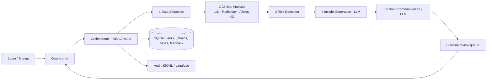

# ClinicalChat

ClinicalChat is a simple, role-aware **multi-agent clinical chatbot**, built for the *AI-Driven Multi-Role Clinical Intelligence System* problem statement.

It runs the **5-agent clinical workflow** from the course design:

| Step | Agent | Kind | What it does |
|---|---|---|---|
| 1 | 📄 **Data Extraction** | rules | Parses uploads (docx/pdf/txt/xlsx/image + OCR), classifies the report, scores extraction quality, lists missing or ambiguous data, and selects the records relevant to the question. |
| 2 | 🔬 **Clinical Analysis** | rules + KG | Contains the problem-statement specialists: **Lab Interpreter** (reference ranges, patterns), **Radiology Analyzer** (findings, red flags) and **Allergy Safety** (NetworkX cross-reactivity, drug checks). Adds a symptom → condition differential and a symptom/report consistency check. |
| 3 | 🚨 **Risk Detection** | rules | LOW / MODERATE / HIGH / CRITICAL from critical labs, imaging red flags, red-flag symptoms and multiple conditions; decides escalation. |
| 4 | 💡 **Insight Generation** | LLM (1 call) | Structured insight, possible conditions, next steps, missing data and a confidence score. Low confidence, missing data, contradictions or escalation → **Review required**. |
| 5 | 💬 **Patient Communication** | LLM (1 call) | Plain-language explanation checked by a deterministic guard (no doses, no definitive diagnosis, no self-medication). **Held until a clinician validates it.** |

An **agent strip** above the chat shows each agent's live state (queued, working, done, skipped, not permitted), and the chat shows a collapsible **Agent activity** log plus "🔎 What the agents found".

### New-patient journey

1. **Sign up** at `/signup` (name, age, gender, username, password, optional allergies and medicines). Self-registered patients always get their own record — they never merge into an existing patient with the same name.
2. **Describe symptoms** in the chat (e.g. "I have fever and cough since 3 days"). Symptoms are saved to the record.
3. **📎 Upload reports** (CBC, X-ray report, discharge summary…). They are parsed, indexed and added to the record.
4. The pipeline runs. **Safety and urgency guidance is shown immediately** (emergency advice is never held back); the AI explanation becomes a case **awaiting clinician review**.
5. A clinician opens the case in the **Review queue**, adds an optional note and clicks **Approve & send** (or **Return**). The note is also stored as feedback for future Insight prompts.
6. The patient's chat receives "✅ Reviewed by Dr. …" automatically; **My case updates** shows the status.
7. **General health questions** ("What is CRP?") are answered directly as information, without touching the record.

### LLM budget (important with rate-limited back ends)

- Routing, extraction, clinical analysis and risk detection use **no LLM calls**.
- Staff question = **1 call** (Insight). Patient case = **2 calls** (Insight + Communication). General question or "explain this to the patient" = **1 call**.
- Responses are cached in SQLite, so asking the same question again is instant and free.
- **Copilot CLI back end:** calls run one at a time; the adapter stops at the first HTTP 429 and a 2-minute circuit breaker blocks further calls.

## Architecture



| Role | Agents | Data |
|---|---|---|
| Patient | all 5 (Communication output reviewed) | own record only; can sign up and upload |
| Clinician | 1–4, plus 5 for "explain this to the patient" | any patient; reviews patient cases |
| Radiologist | 1–4 | imaging + allergy safety |
| Care Coordinator | 1–4 | care summaries across specialties |

## Demo accounts

The password for all accounts is `demo@123` (change it with `DEMO_PASSWORD`).

| Username | Role | Notes |
|---|---|---|
| `dr.sharma` | Clinician | All agents, any patient |
| `dr.iyer` | Radiologist | Radiology and Allergy Safety (contrast safety) |
| `coord.thomas` | Care Coordinator | Care Coordinator and Allergy Safety |
| `ananya.rao` / `rahul.mehta` | Patient | Own lab record only, simplified answers |
| `riya.das` | Patient | Own record (sulfa allergy) |

New patients can create their own account at **`/signup`** (link on the login page).

These example queries from the problem statement are available as one-click suggestions:

- "Interpret my CBC results."
- "Analyze this patient's complete metabolic panel."
- "Review the chest CT findings."
- "Check for drug allergies before prescribing ibuprofen."
- "What are the cross-reactivities for this sulfa allergy?"
- "Summarize this patient's care status for handoff."
- "What follow-up tests are recommended based on these results?"
- "Explain my thyroid results in simple terms."

## Run locally

```bash
uv venv --python 3.11 .venv
uv pip install --python .venv/bin/python -e ".[dev]"
cp .env.example .env               # set OPENAI_API_KEY, or leave empty to use the Copilot CLI
.venv/bin/clinicalchat ingest      # parse data/raw + build the vector index (about 30 s on first run)
.venv/bin/clinicalchat serve       # http://localhost:7860
```

You can also ask from the terminal:

```bash
.venv/bin/clinicalchat ask "Explain my thyroid results in simple terms." --user rahul.mehta
.venv/bin/clinicalchat ask "Check for drug allergies before prescribing ibuprofen." --user dr.sharma --patient sneha-gupta-42
```

Tests use a fake LLM, so they make no real calls:

```bash
.venv/bin/python -m pytest
```

## Docker

```bash
docker build -t clinicalchat .
docker run -p 7860:7860 -e OPENAI_API_KEY=sk-... -v clinicalchat-state:/app/data/state clinicalchat
```

Signed-up users, uploads, cases and review feedback live in `data/state/clinicalchat.db` (git-ignored); mount it as a volume to keep them across restarts.

`GET /health` returns `{"status": "ok", ...}`; load balancers can use it for health checks.

## Data

`data/raw` contains the dataset provided with the problem statement:

- lab reports (including a scanned CBC PDF, read with OCR)
- radiology reports
- allergy records (food, medication, environment, skin)
- patient records
- a medical glossary

The documents are split into per-patient sections, giving 70 patients and 164 sections.

---

_ClinicalChat is AI decision support for demonstration and education. It is not a medical device and does not replace professional clinical judgement._
