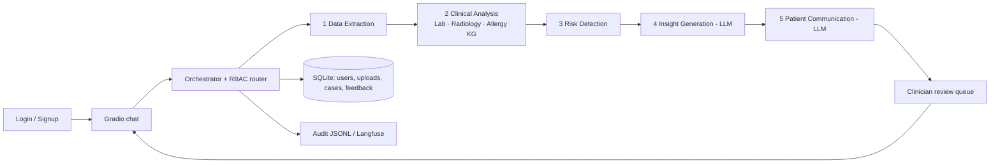

# ClinicalChat

ClinicalChat is a simple, role-aware **multi-agent clinical chatbot**, built for the *AI-Driven Multi-Role Clinical Intelligence System* problem statement.

It runs the **5-agent clinical workflow** from the course design:

| Step | Agent | Kind | What it does |
|---|---|---|---|
| 1 | 📄 **Data Extraction** | rules | Parses uploads (docx/pdf/txt/xlsx/image + OCR), classifies the report, scores extraction quality, lists missing or ambiguous data, and selects the records relevant to the question. |
| 2 | 🔬 **Clinical Analysis** | rules + KG | Contains the problem-statement specialists: **Lab Interpreter** (reference ranges, patterns), **Radiology Analyzer** (findings, red flags) and **Allergy Safety** (NetworkX cross-reactivity, drug checks). Adds a symptom → condition differential and a symptom/report consistency check. |
| 3 | 🚨 **Risk Detection** | rules | LOW / MODERATE / HIGH / CRITICAL from critical labs, imaging red flags, red-flag symptoms and multiple conditions; decides escalation. |
| 4 | 💡 **Insight Generation** | LLM (1 call) | Structured insight, possible conditions, next steps, missing data and a confidence score. Low confidence, missing data, contradictions or escalation → **Review required**. |
| 5 | 💬 **Patient Communication** | LLM (1 call) | Plain-language explanation checked by a deterministic guard (no doses, no definitive diagnosis, no self-medication). Shown to the patient **immediately** as an AI assessment (risk, AI-predicted possible conditions, confidence) with a **case ID**; wording that fails the guard is withheld until a clinician checks it. |

An **agent strip** above the chat shows each agent's live state (queued, working, done, skipped, not permitted), and the chat shows a collapsible **Agent activity** log plus "🔎 What the agents found".

### New-patient journey

1. **Sign up** at `/signup` (name, age, gender, username, password, optional allergies and medicines). Self-registered patients always get their own record — they never merge into an existing patient with the same name.
2. **Describe symptoms** in the chat (e.g. "I have fever and cough since 3 days"). Symptoms are saved to the record.
3. **📎 Attach reports** (up to 10 at once — PDF, Word, Excel, text or a photo/scan) and press **Send**, with or without a message such as *"I have fever for 4 days — here are my reports, can I take ibuprofen?"* — each attached file shows as a chip with its own × to remove it before sending. Each file is checked on its own (unreadable files, duplicates and reports carrying **another person's name** are not added); the accepted reports and the message then go through **one** pipeline run — the same LLM cost as a single question.
4. The pipeline runs. **Safety and urgency guidance** and the **AI assessment of the current health condition** (risk level, possible conditions — clearly not a diagnosis — and a plain-language explanation) are shown immediately, together with a **case ID**.
   - **One open case per patient:** follow-up questions and new reports update the same case (the care team sees the full message history and the risk level never drops before review). A new case is opened only after the clinician has closed the previous one.
5. The case moves through the **care team** (see below). The patient's **My case updates** tile shows a step tracker, and *"What is the status of my case?"* is answered from the workflow (no LLM call).
6. The patient's chat receives "✅ Case C-… confirmed by Dr. …" or "↩️ … needs more information" automatically. A reply goes into the same case.
7. **General health questions** ("What is CRP?") are answered directly as information, without touching the record.

### Care-team workflow (role-based)

```
Patient case ──► 🩻 Radiologist ──► 🧭 Care Coordinator ──► 👩‍⚕️ Assigned clinician ──► ✅ Confirmed
 (AI assessment   only if the case    sets priority            confirms, or ↩️ asks the
  shown at once)  has unread imaging  (Urgent/Soon/Routine)    patient for more info
                                      + assigns a clinician
```

| Stage | Who | Queue | Sees | Action |
|---|---|---|---|---|
| 🩻 With radiologist | `dr.iyer` | **Imaging queue** | Imaging reports, extracted impression / red flags, allergies + **iodinated-contrast check** (no lab results — RBAC) | Verdict (agree / additional findings / **critical**) + written read → **Submit read** |
| 🧭 With care coordinator | `coord.thomas` | **Triage queue** + case board | Risk flags, report types, AI possibilities and next steps, radiology read; suggested priority from risk | Priority + assigned clinician + hand-off note → **Route to clinician** |
| ⏳ With clinician | assigned clinician (`dr.sharma` / `dr.menon`) | **Review queue** (only cases assigned to them) | Full findings, AI insight, radiology read, triage note, text shown to the patient | **Approve & send** or **Return** (note is reused as Insight feedback) |

Routing rules:
- Imaging (X-ray, CT, MRI, ultrasound) not yet read by a radiologist → radiologist first. **Allergy-only reports do not go to the radiologist**; the radiologist sees allergies only to judge contrast safety.
- A **critical** radiology read raises the case to CRITICAL and sends it back to triage, even if it was already assigned.
- A patient reply to a returned case goes straight back to the assigned clinician, unless it adds new imaging (then radiologist first).
- **AI busy or rate-limited?** The case is still created and routed. It uses the rule-based findings (risk, abnormal values, imaging flags), so reports always reach the care team. The patient gets the AI explanation by asking again, and that updates the same case.
- Each stage is checked server-side (a clinician cannot confirm an un-triaged case, the coordinator cannot triage before the radiology read, and only clinicians can be assigned). Every step is written to the case timeline and the audit log.

### When is a case opened? (patients)

A case is work for the care team, so simple doubts don't create one. A patient question opens or updates the single open case only when:
- new reports are attached or new symptoms are mentioned;
- the patient asks for a doctor ("please ask my doctor to review this");
- the clinician returned the case and is waiting for the patient's reply; or
- (**safety net**) the records escalate (HIGH/CRITICAL) and no case has covered this evidence yet.

Any other personal question ("what do my reports mean?", "is it serious?") is just answered. If there is an open case, the answer says so and the case is not changed.

### LLM budget (important with rate-limited back ends)

- Routing, extraction, clinical analysis and risk detection use **no LLM calls**.
- Staff question = **1 call** (Insight). Patient question with new evidence = **2 calls** (Insight + Communication). Patient follow-up with **nothing new** = **1 call**: the last Insight for that patient is reused while their reports, symptoms/allergies, radiologist reads and risk level are unchanged. General question or "explain this to the patient" = **1 call**.
- Responses are cached in SQLite, so asking the same question again is instant and free.
- **Copilot CLI back end:** calls run one at a time; the adapter stops at the first HTTP 429 and a 2-minute circuit breaker blocks further calls.

## Architecture



| Role | Agents | Data |
|---|---|---|
| Patient | all 5 (Communication output reviewed) | own record only; can sign up and upload |
| Clinician | 1–4, plus 5 for "explain this to the patient" | any patient; reviews patient cases |
| Radiologist | 1–4 | imaging + allergy safety |
| Care Coordinator | 1–4 | care summaries across specialties |

## Demo accounts

The password for all accounts is `demo@123` (change it with `DEMO_PASSWORD`).

| Username | Role | Notes |
|---|---|---|
| `dr.sharma` / `dr.menon` | Clinician | All agents, any patient; **Review queue** for cases assigned to them |
| `dr.iyer` | Radiologist | Imaging and allergy (contrast safety) records only; **Imaging queue** |
| `coord.thomas` | Care Coordinator | All records, operational answers; **Triage queue** and case board |
| `ananya.rao` / `rahul.mehta` | Patient | Own lab record only, simplified answers |
| `riya.das` | Patient | Own record (sulfa allergy) |

New patients can create their own account at **`/signup`** (link on the login page).

These example queries from the problem statement are available as one-click suggestions:

- "Interpret my CBC results."
- "Analyze this patient's complete metabolic panel."
- "Review the chest CT findings."
- "Check for drug allergies before prescribing ibuprofen."
- "What are the cross-reactivities for this sulfa allergy?"
- "Summarize this patient's care status for handoff."
- "What follow-up tests are recommended based on these results?"
- "Explain my thyroid results in simple terms."

## Run locally

```bash
uv venv --python 3.11 .venv
uv pip install --python .venv/bin/python -e ".[dev]"
cp .env.example .env               # set OPENAI_API_KEY, or leave empty to use the Copilot CLI
.venv/bin/clinicalchat ingest      # parse data/raw + build the vector index (about 30 s on first run)
.venv/bin/clinicalchat serve       # http://localhost:7860
```

You can also ask from the terminal:

```bash
.venv/bin/clinicalchat ask "Explain my thyroid results in simple terms." --user rahul.mehta
.venv/bin/clinicalchat ask "Check for drug allergies before prescribing ibuprofen." --user dr.sharma --patient sneha-gupta-42
```

Tests use a fake LLM, so they make no real calls:

```bash
.venv/bin/python -m pytest
```

## Docker

```bash
docker build -t clinicalchat .
docker run -p 7860:7860 -e OPENAI_API_KEY=sk-... -v clinicalchat-state:/app/data/state clinicalchat
```

Signed-up users, uploads, cases and review feedback live in `data/state/clinicalchat.db` (git-ignored); mount it as a volume to keep them across restarts.

`GET /health` returns `{"status": "ok", ...}`; load balancers can use it for health checks.

## Data

`data/raw` contains the dataset provided with the problem statement:

- lab reports (including a scanned CBC PDF, read with OCR)
- radiology reports
- allergy records (food, medication, environment, skin)
- patient records
- a medical glossary

The documents are split into per-patient sections, giving 70 patients and 164 sections.

---

_ClinicalChat is AI decision support for demonstration and education. It is not a medical device and does not replace professional clinical judgement._
