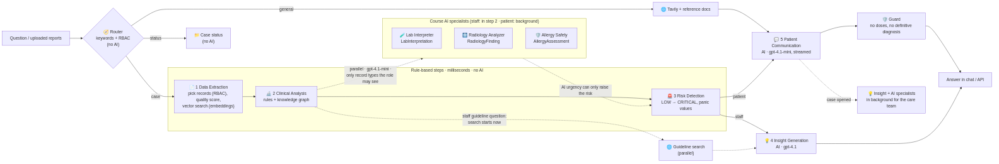

# ClinicalChat

ClinicalChat is a simple, role-aware **multi-agent clinical chatbot**, built for the *AI-Driven Multi-Role Clinical Intelligence System* problem statement.

It runs the **5-agent clinical workflow** from the course design:

| Step | Agent | Kind | What it does |
|---|---|---|---|
| 1 | 📄 **Data Extraction** | rules | Parses uploads (docx/pdf/txt/xlsx/image + OCR), classifies the report, scores extraction quality, lists missing or ambiguous data, and selects the records relevant to the question. |
| 2 | 🔬 **Clinical Analysis** | rules + KG | Contains the problem-statement specialists: **Lab Interpreter** (reference ranges, patterns), **Radiology Analyzer** (findings, red flags) and **Allergy Safety** (NetworkX cross-reactivity, drug checks). Adds a symptom → condition differential and a symptom/report consistency check. Optionally adds the course's three **AI specialists** (Lab Interpreter, Radiology Analyzer, Allergy Safety — structured Pydantic output, in parallel, role-scoped; AI urgency can only raise the risk). |
| 3 | 🚨 **Risk Detection** | rules | LOW / MODERATE / HIGH / CRITICAL from critical labs, imaging red flags, red-flag symptoms and multiple conditions; decides escalation. |
| 4 | 💡 **Insight Generation** | LLM (1 call) | Structured insight, possible conditions, next steps, missing data and a confidence score. Low confidence, missing data, contradictions or escalation → **Review required**. |
| 5 | 💬 **Patient Communication** | LLM (1 call) | Plain-language explanation checked by a deterministic guard (no doses, no definitive diagnosis, no self-medication). Shown to the patient **immediately** as an AI assessment (risk, AI-predicted possible conditions, confidence) with a **case ID**; wording that fails the guard is withheld until a clinician checks it. |

The project follows the course's Week 1–8 notebooks — see [docs/COURSE_ALIGNMENT.md](docs/COURSE_ALIGNMENT.md) for the week-by-week mapping.

An **agent strip** above the chat shows each agent's live state (queued, working, done, skipped, not permitted), and the chat shows a collapsible **Agent activity** log plus "🔎 What the agents found".

### New-patient journey

1. **Sign up** at `/signup` (name, age, gender, username, password, optional allergies and medicines). Self-registered patients always get their own record — they never merge into an existing patient with the same name.
2. **Describe symptoms** in the chat (e.g. "I have fever and cough since 3 days"). Symptoms are saved to the record.
3. **📎 Attach reports** (up to 10 at once — PDF, Word, Excel, text or a photo/scan) and press **Send**, with or without a message such as *"I have fever for 4 days — here are my reports, can I take ibuprofen?"* — each attached file shows as a chip with its own × to remove it before sending. Each file is checked on its own (unreadable files, duplicates and reports carrying **another person's name** are not added); the accepted reports and the message then go through **one** pipeline run — the same LLM cost as a single question.
4. The pipeline runs. **Safety and urgency guidance** and the **AI assessment of the current health condition** (risk level, possible conditions — clearly not a diagnosis — and a plain-language explanation) are shown immediately, together with a **case ID**.
   - **One open case per patient:** follow-up questions and new reports update the same case (the care team sees the full message history and the risk level never drops before review). A new case is opened only after the clinician has closed the previous one.
5. The case moves through the **care team** (see below). The patient's **My case updates** tile shows a step tracker, and *"What is the status of my case?"* is answered from the workflow (no LLM call).
6. The patient's chat receives "✅ Case C-… confirmed by Dr. …" or "↩️ … needs more information" automatically. A reply goes into the same case.
7. **General health questions** ("What is CRP?") are answered directly as information, without touching the record.

### Care-team workflow (role-based)

```
Patient case ──► 🩻 Radiologist ──► 🧭 Care Coordinator ──► 👩‍⚕️ Assigned clinician ──► ✅ Confirmed
 (AI assessment   only if the case    sets priority            confirms, or ↩️ asks the
  shown at once)  has unread imaging  (Urgent/Soon/Routine)    patient for more info
                                      + assigns a clinician
```

| Stage | Who | Queue | Sees | Action |
|---|---|---|---|---|
| 🩻 With radiologist | `dr.iyer` | **Imaging queue** | Imaging reports, extracted impression / red flags, allergies + **iodinated-contrast check** (no lab results — RBAC) | Verdict (agree / additional findings / **critical**) + written read → **Submit read** |
| 🧭 With care coordinator | `coord.thomas` | **Triage queue** + case board | Risk flags, report types, AI possibilities and next steps, radiology read; suggested priority from risk | Priority + assigned clinician + hand-off note → **Route to clinician** |
| ⏳ With clinician | assigned clinician (`dr.sharma` / `dr.menon`) | **Review queue** (only cases assigned to them) | Full findings, AI insight, radiology read, triage note, text shown to the patient | **Approve & send** or **Return** (note is reused as Insight feedback) |

Routing rules:
- Imaging (X-ray, CT, MRI, ultrasound) not yet read by a radiologist → radiologist first. **Allergy-only reports do not go to the radiologist**; the radiologist sees allergies only to judge contrast safety.
- A **critical** radiology read raises the case to CRITICAL and sends it back to triage, even if it was already assigned.
- A patient reply to a returned case goes straight back to the assigned clinician, unless it adds new imaging (then radiologist first).
- **AI busy or rate-limited?** The case is still created and routed. It uses the rule-based findings (risk, abnormal values, imaging flags), so reports always reach the care team. The patient gets the AI explanation by asking again, and that updates the same case.
- Each stage is checked server-side (a clinician cannot confirm an un-triaged case, the coordinator cannot triage before the radiology read, and only clinicians can be assigned). Every step is written to the case timeline and the audit log.

### When is a case opened? (patients)

A case is work for the care team, so simple doubts don't create one. A patient question opens or updates the single open case only when:
- new reports are attached or new symptoms are mentioned;
- the patient asks for a doctor ("please ask my doctor to review this");
- the clinician returned the case and is waiting for the patient's reply; or
- (**safety net**) the records escalate (HIGH/CRITICAL) and no case has covered this evidence yet.

Any other personal question ("what do my reports mean?", "is it serious?") is just answered. If there is an open case, the answer says so and the case is not changed.

### LLM budget

- Routing, extraction, clinical analysis and risk detection use **no LLM calls**.
- **Patient question = 1 call** (Communication, fast model), whatever it is. Communication works from the automatic findings, or from the last Insight if one exists. When a case is opened, Insight (strong model) is written **in the background** for the care team, and the patient does not wait for it. Insight is reused while the patient's reports, symptoms/allergies, radiologist reads and risk level are unchanged.
- Staff question = **1 call** (Insight) + **1 per AI specialist** that applies (in parallel; cached because the specialist input does not depend on the question's wording). General question = **1 call**, or **0** if a same or similar question was answered in the last 7 days. "Explain this to the patient" = **1 call**.
- Responses are cached in SQLite, so asking the same question again is instant and free.

### Response time

| Step | Time |
|---|---|
| Routing, report checks, clinical analysis, risk, safety alerts (no AI) | ~10–70 ms, shown **instantly** as "⚡ Quick check" |
| Reading attached reports | files are read/OCR'd **in parallel** (up to 4 at a time) |
| AI answer — OpenAI (`gpt-4.1-mini`, streamed) | **measured:** first words 0.9–1.8 s, finished 2.2–3.3 s |
| Care-team Insight — OpenAI (`gpt-4.1`, background) | ~3 s after the patient's answer; the patient never waits for it |
| Repeated / similar general question | instant (FAQ cache, no AI) |
| Staff question with AI specialists (`gpt-4.1-mini`, parallel) + Insight | **measured:** 8.5–10 s first time, ~5 s when the specialists are cached |

What makes it fast:
- **One AI call per patient question.** The care-team Insight runs in the background.
- **Fast/strong model split.** `OPENAI_FAST_MODEL` (default `gpt-4.1-mini`) writes patient answers. `OPENAI_MODEL` (default `gpt-4.1`) writes the clinical Insight.
- **Short outputs.** Token caps (`COMMUNICATION_MAX_TOKENS`, `INSIGHT_MAX_TOKENS`), JSON mode, trimmed record excerpts and the last 2 chat turns only.
- **Streaming.** The answer appears word by word. The safety guard checks the text as it streams. If wording looks unsafe (e.g. a dose), it pauses on "Checking the wording…" and only the checked final answer is shown.
- **Warm start.** The OpenAI connection is opened when the server starts. This does not use tokens.
- **FAQ cache.** General questions are matched on their key terms (and the patient's allergies).

To use OpenAI, copy the template and put the keys in **`.env`**, then restart. Without `OPENAI_API_KEY` the app still runs and answers from the rule-based findings only:

```bash
cp .env.example .env && chmod 600 .env   # .env is git-ignored
# edit .env: OPENAI_API_KEY=sk-...  (optional) LANGFUSE_PUBLIC_KEY=pk-lf-...  LANGFUSE_SECRET_KEY=sk-lf-...
```

> ⚠️ Never put real keys in `.env.example`. It is committed to git.

With the Langfuse keys set, every question becomes one Langfuse trace: a span per agent step, tool (knowledge graph, vector search, embeddings, web search) and AI call (model, prompt, tokens, latency), plus scores (`insight_confidence`, `lab_interpreter_confidence`, …, `risk_level`, `review_required`, `rbac_blocked`). Uploads and care-team actions are traced too. The JSONL audit log in `data/audit/` is always on.

### AI specialists (course Week 4)

| Setting | Default | Meaning |
|---|---|---|
| `SPECIALIST_AGENTS` | `auto` | `auto` = on when `OPENAI_API_KEY` is set · `llm` = always · `rules` = off (rule-based analysis only) |
| `OPENAI_SPECIALIST_MODEL` | `gpt-4.1-mini` | Same output as the course's `gpt-4o-mini`, measured ~2.5× faster here |
| `SPECIALIST_MAX_TOKENS` | `900` | Output cap per specialist |

### 🌐 Web search (Tavily, trusted sites only)

With `TAVILY_API_KEY` set, three steps can use current information from trusted medical sites:

| Where | When | Sites | Effect |
|---|---|---|---|
| Patient general question | every general question (waits ≤ 2.5 s, then answers without it) | WHO, NIH/MedlinePlus, CDC, NHS, Mayo Clinic, Cleveland Clinic… | answer uses the sources; links listed under "🌐 From trusted health sites" |
| Clinician / radiologist / coordinator | the question asks for guidelines, evidence, treatment, management, dosing… | NICE, NCBI/PubMed, KDIGO, AHA/ACC, IDSA, Radiopaedia… | Insight cites `[W1]…` and lists the sources |
| Medicine the knowledge graph does not know | "can I take / is X safe / prescribed X" with an unknown brand | DailyMed, MedlinePlus, drugs.com, 1mg, EMA, FDA | ingredients found → the normal allergy / interaction checks run on them |

Guardrails:
- **No patient details leave the server.** Patient names, record keys, IDs/MRNs, dates, phone numbers and e-mails are stripped from every query (`domain/privacy.py`). Drug look-ups send only the medicine name.
- **Only trusted domains.** They are passed to Tavily and checked again on every result.
- **Web results can only add warnings.** They never change the risk level or clear an allergy warning. If a medicine's ingredients can't be recognised, it says so and asks the patient to check with a pharmacist.
- **Logged and cached.** Results are cached for 7 days (`web_cache` table), each search is in the audit log (`web_searches`) and appears as a span in Langfuse.
- **Optional.** Without a key, or with `WEB_SEARCH=off`, the app behaves exactly as before.

## Architecture



The code is split into layers. Each layer only uses the layers below it, and `container.py` creates and wires every object (dependency injection):

```text
src/clinicalchat/
├── cli.py            clinicalchat serve | ingest | ask | reset-patient
├── config.py         settings from .env
├── container.py      composition root: builds and wires everything
├── web/              FastAPI + Gradio: app, layout, controller, chat renderer, sidebar, components, theme
├── services/         use cases: chat, uploads, pipeline, responders, cases, care team, web enrichment, accounts…
├── presenters/       Markdown for findings, answers, case status and role-specific case views
├── agents/           the 5 agents, 4 specialists, the guard and the shared LLM base / prompts
├── ingestion/        DOCX / PDF / OCR / XLSX readers, per-patient sections, lab tables, registry
├── knowledge/        medical ontology + NetworkX knowledge graph
├── infrastructure/   SQLite repositories, ChromaDB, OpenAI models + cache, Tavily, Langfuse, audit log
└── domain/           models, roles (RBAC), risk, case workflow, personas, conversation
```

| Document | What it covers |
|---|---|
| [docs/ARCHITECTURE.md](docs/ARCHITECTURE.md) | Diagrams: system context, layers, DI wiring, agent pipeline, question sequence, upload flow, case states, deployment; SOLID mapping |
| [docs/FILE_GUIDE.md](docs/FILE_GUIDE.md) | Every file: what it does, who calls it, and how |
| [docs/HOW_IT_WORKS.md](docs/HOW_IT_WORKS.md) | Plain-English tour of the agents and the tools they use |
| [docs/COURSE_ALIGNMENT.md](docs/COURSE_ALIGNMENT.md) | Week 1–8 course notebooks → files in this project |
| [deployment/README.md](deployment/README.md) | Step-by-step AWS EC2 deployment (systemd, port 8000) |

| Role | Agents | Record types (course RBAC) |
|---|---|---|
| Patient | all 5 (Communication output reviewed) | own record only (all types); can sign up and upload |
| Clinician | 1–4, plus 5 for "explain this to the patient" | lab, allergy, patient record, reference; radiology hand-over notes on assigned cases |
| Radiologist | 1–4 | radiology, reference; the iodinated-contrast safety alert is still shown |
| Care Coordinator | 1–4 | all |

## Demo accounts

The password for all accounts is `demo@123` (change it with `DEMO_PASSWORD`).

| Username | Role | Notes |
|---|---|---|
| `dr.sharma` / `dr.menon` | Clinician | All agents, any patient (lab, allergy and patient records); **Review queue** for cases assigned to them |
| `dr.iyer` | Radiologist | Imaging records only (plus the contrast-safety alert); **Imaging queue** |
| `coord.thomas` | Care Coordinator | All records, operational answers; **Triage queue** and case board |
| `ananya.rao` / `rahul.mehta` | Patient | Own lab record only, simplified answers |
| `riya.das` | Patient | Own record (sulfa allergy) |

New patients can create their own account at **`/signup`** (link on the login page).

These example queries from the problem statement are available as one-click suggestions:

- "Interpret my CBC results."
- "Analyze this patient's complete metabolic panel."
- "Review the chest CT findings."
- "Check for drug allergies before prescribing ibuprofen."
- "What are the cross-reactivities for this sulfa allergy?"
- "Summarize this patient's care status for handoff."
- "What follow-up tests are recommended based on these results?"
- "Explain my thyroid results in simple terms."

## Run locally

```bash
uv venv --python 3.11 .venv
uv pip install --python .venv/bin/python -e ".[dev]"
cp .env.example .env               # set OPENAI_API_KEY (and optionally TAVILY / LANGFUSE keys)
.venv/bin/clinicalchat ingest      # parse data/raw + build the vector index (about 30 s on first run)
.venv/bin/clinicalchat serve       # http://localhost:7860
```

You can also ask from the terminal:

```bash
.venv/bin/clinicalchat ask "Explain my thyroid results in simple terms." --user rahul.mehta
.venv/bin/clinicalchat ask "Check for drug allergies before prescribing ibuprofen." --user dr.sharma --patient sneha-gupta-42
```

### REST API

The same assistant is available over HTTP (log in with the same username / password; Swagger UI at `/docs`):

```bash
curl -s localhost:7860/api/health
curl -s -u dr.sharma:demo@123 localhost:7860/api/status
curl -s -u dr.sharma:demo@123 -H 'content-type: application/json' \
     -d '{"query": "Interpret her kidney function results", "patient": "ananya-rao-54"}' localhost:7860/api/query
curl -s -u ananya.rao:demo@123 localhost:7860/api/allergy/latex
```

`/api/query` returns the answer, risk level, agents that ran, any safety banner and the Langfuse `trace_id`. Pass `session_id` back for follow-up questions.

The **🛡️ Allergy Safety Check** tile in the sidebar shows the same allergy card in the chat.

Tests use a fake LLM, so they make no real calls:

```bash
.venv/bin/python -m pytest
```

### Reset a patient (for re-testing)

```bash
# stop the server first (it keeps patient data in memory)
clinicalchat reset-patient robin.hood            # username or patient key; asks for confirmation
clinicalchat reset-patient robin.hood --delete-login --yes
```

This removes the patient's uploads, search-index chunks, symptoms/allergies, cases and their review history, the cached insight and chat exports. Dataset records and other patients are not touched. The JSONL audit log is append-only and is kept.

## Deploy (AWS EC2)

See [deployment/README.md](deployment/README.md): launch an Ubuntu EC2 instance, clone the repo, run `bash deployment/ec2-setup.sh`, put the keys in `.env`, and the app runs as the `clinicalchat` systemd service on **port 8000**. Stopping the service lets background care-team work finish and flushes Langfuse traces.

## Docker

```bash
docker build -t clinicalchat .
docker run -p 8000:8000 --env-file .env -e PORT=8000 -v clinicalchat-data:/app/data clinicalchat
```

Signed-up users, uploads, cases and review feedback live in `data/state/clinicalchat.db` (git-ignored); the volume keeps them across restarts.

`GET /api/health` returns `{"status": "ok"}`; load balancers and the Docker `HEALTHCHECK` use it. `GET /health` (no log-in) also reports the model, web search and tracing status.

## Data

`data/raw` contains the dataset provided with the problem statement:

- lab reports (including a scanned CBC PDF, read with OCR)
- radiology reports
- allergy records (food, medication, environment, skin)
- patient records
- a medical glossary

The documents are split into per-patient sections, giving 70 patients and 164 sections.

---

_ClinicalChat is AI decision support for demonstration and education. It is not a medical device and does not replace professional clinical judgement._
