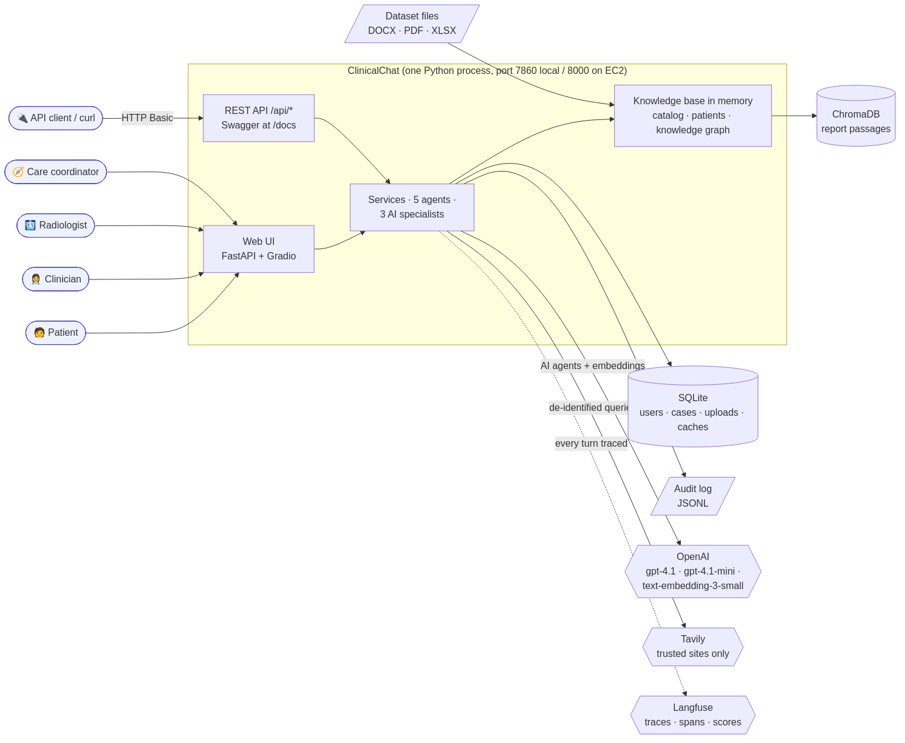
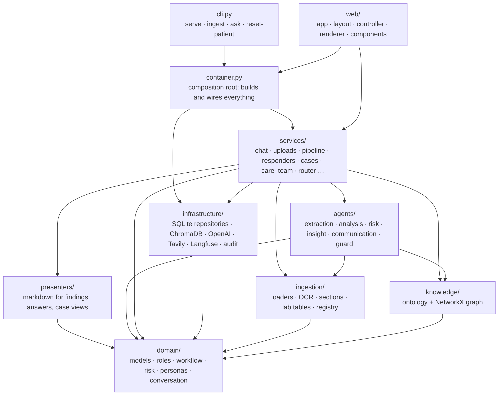
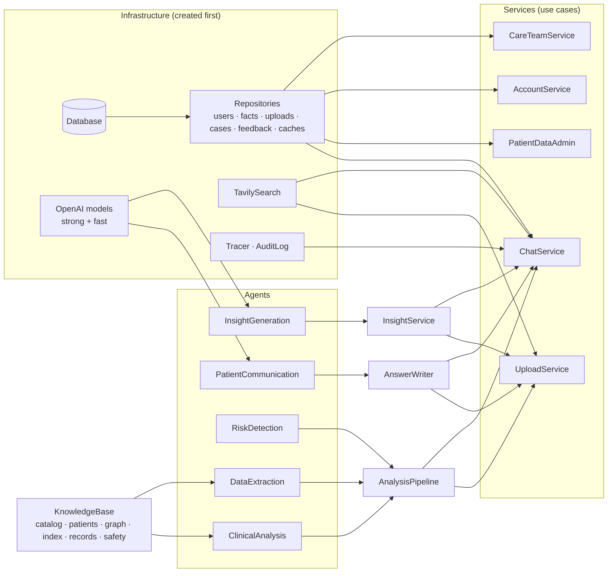
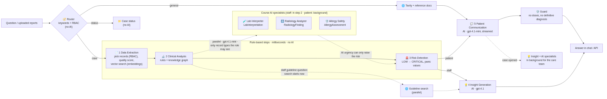
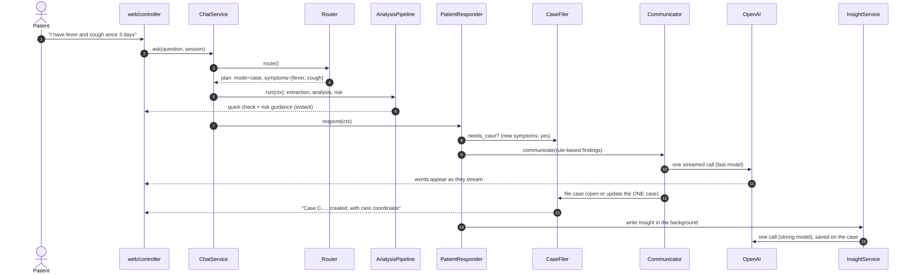
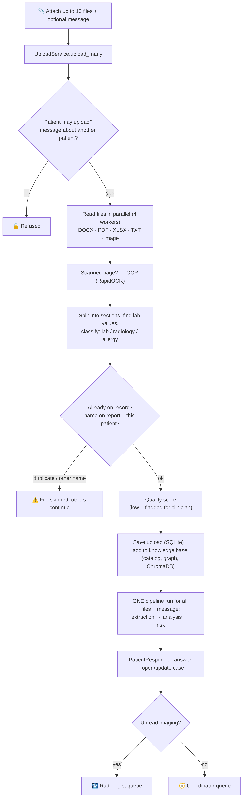
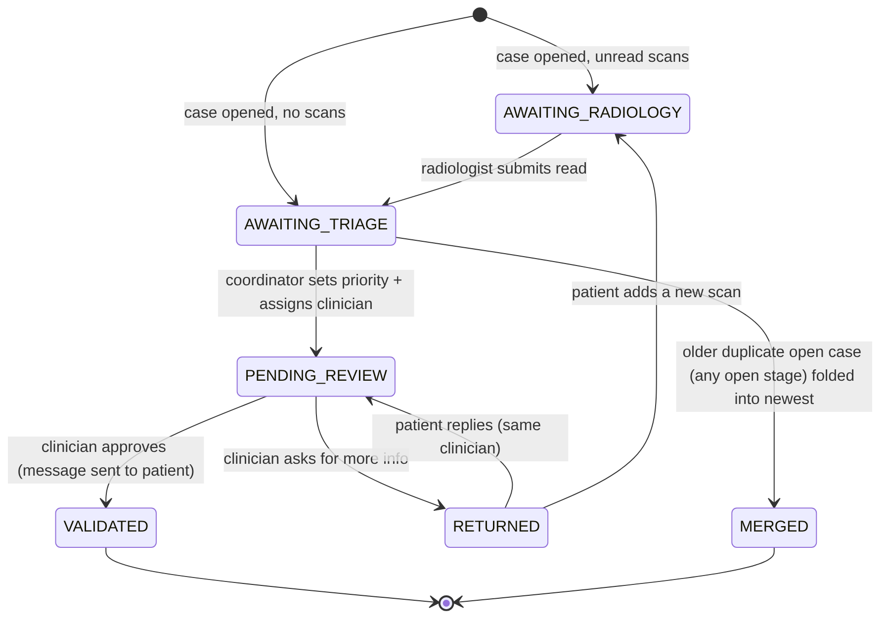
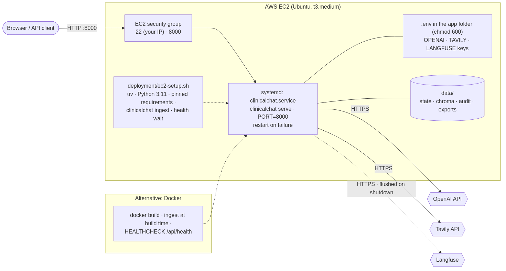
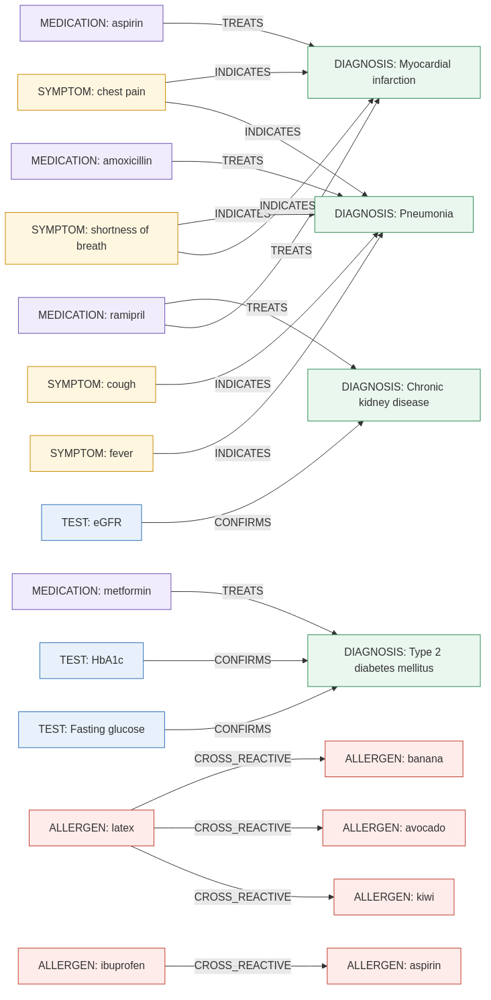

> **Generated**: 2026-11-16 04:21 UTC
> **Updated**: 2026-11-16 15:30 UTC
> **Project**: ClinicalChat — multi-agent clinical chatbot (HealthCare capstone)
> **Status**: Final

# ClinicalChat architecture

This document covers the system end to end with diagrams: who uses it, how the code is layered, how a question and an upload travel through the agents, how a case moves through the care team, and how it will be deployed.

Companion docs:
- [FILE_GUIDE.md](FILE_GUIDE.md): every file, who calls it and how.
- [HOW_IT_WORKS.md](HOW_IT_WORKS.md): the same story in plain English.
- [COURSE_ALIGNMENT.md](COURSE_ALIGNMENT.md): how the Week 1–8 course notebooks map onto this code.

Every diagram has a Mermaid source in [`diagrams/src/`](diagrams/src) and a rendered PNG in [`diagrams/`](diagrams).

## Table of Contents
- [1. System context](#1-system-context)
- [2. Layers and dependency rule](#2-layers-and-dependency-rule)
- [3. Composition root (dependency injection)](#3-composition-root-dependency-injection)
- [4. The five-agent pipeline](#4-the-five-agent-pipeline)
- [5. A patient question, end to end](#5-a-patient-question-end-to-end)
- [6. Report upload flow](#6-report-upload-flow)
- [7. Case workflow across the care team](#7-case-workflow-across-the-care-team)
- [8. Deployment](#8-deployment)
- [9. Cross-cutting concerns](#9-cross-cutting-concerns)
- [10. How SOLID is applied](#10-how-solid-is-applied)
- [11. Knowledge graph](#11-knowledge-graph)
- [Revision History](#revision-history)

---

## 1. System context

- **One Python process** runs everything. FastAPI serves the Gradio UI and a REST API (`/api/*`, Swagger at `/docs`) on port 7860 locally, 8000 on EC2.
- **In memory**:
  - the knowledge base built from the dataset and uploads: document catalog, patient directory, NetworkX graph.
- **On disk**:
  - SQLite holds users, cases, uploads and caches;
  - ChromaDB holds the vector index;
  - JSONL files hold the audit log.
- **External services** are all optional. Each one is switched on by a key in `.env`.
  - **OpenAI**: the two AI agents, the three AI specialists and the embeddings (`text-embedding-3-small`; local MiniLM without a key).
  - **Tavily**: search of trusted medical sites, with de-identified queries.
  - **Langfuse**: one trace per chat turn, with a span per agent / tool and confidence scores.
  - Without OpenAI, answers fall back to the rule-based findings.

## 2. Layers and dependency rule

| Layer | Responsibility | May depend on |
|-------|----------------|---------------|
| `web/` | UI only: layout, event handlers, rendering events into chat bubbles. | `container`, `services`, `presenters`, `domain` |
| `services/` | Use cases: answer a question, upload reports, move a case. | `agents`, `presenters`, `ingestion`, `knowledge`, `infrastructure`, `domain` |
| `agents/` | The 5 agents and 4 specialists. Each one has a single analysis job. | `knowledge`, `ingestion`, `domain` |
| `presenters/` | Pure Markdown formatting of results. | `domain` |
| `ingestion/` | Turning files into `ClinicalDocument`s. | `domain` |
| `knowledge/` | Ontology and the NetworkX graph. | `domain` |
| `infrastructure/` | SQLite, ChromaDB, OpenAI, Tavily, Langfuse, audit log. | `domain`, `config` |
| `domain/` | The vocabulary: models, roles (RBAC), risk, workflow, conversation. | nothing |

**Rule:** arrows only point down. `domain/` knows nothing about Gradio, SQLite or OpenAI. The web layer never reaches into a repository directly; it goes through a service.

## 3. Composition root (dependency injection)

`container.py` is the **only** place where objects are created. `build_container()` builds them in this order:

1. Database, then repositories.
2. KnowledgeBase.
3. OpenAI models: the strong `gpt-4.1` (Insight), the fast `gpt-4.1-mini` (Communication) and the specialist model (`gpt-4.1-mini`, the three course specialists in a `SpecialistPanel`).
4. Tavily, Tracer, AuditLog.
5. The agents.
6. The services: pipeline, insight, writer, case filer, responders, chat, uploads, care team, accounts, admin, export.

Every class receives its collaborators through `__init__`. As a result:

- Tests replace OpenAI and Tavily with fakes: `build_container(llm=FakeLLM(), web=NoWeb())`.
- Changing a dependency is a one-line edit in the container.
- `get_container()` gives the web app and the CLI the same thread-safe singleton.

## 4. The five-agent pipeline

| Step | Agent | Kind | Output |
|------|-------|------|--------|
| 0 | 🧭 Router | Keywords and RBAC, no AI | Mode (status / general / explain / case), patient, record domains, drugs, symptoms |
| 1 | 📄 Data Extraction | Rules | The records relevant to the question, and a quality score |
| 2 | 🔬 Clinical Analysis | Rules and the knowledge graph | Lab, radiology, allergy and symptom findings, plus inconsistencies |
| 2b | 🧪 🩻 🛡️ AI specialists (course Week 4) | **AI**, gpt-4.1-mini, up to 3 parallel calls | `LabInterpretation` / `RadiologyFinding` / `AllergyAssessment` for the record types the role may see. Staff: while they wait. Patients: in the background, attached to the case. |
| 3 | 🚨 Risk Detection | Rules (+ AI urgency, raise only) | Risk level LOW to CRITICAL, and whether to escalate |
| 4 | 💡 Insight Generation | **AI**, gpt-4.1, one call | A structured clinical summary for staff |
| 5 | 💬 Patient Communication | **AI**, gpt-4.1-mini, one streamed call | A plain-language answer, checked by the 🛡️ guard |

**AI budget**
- A staff question costs one call (Insight), plus one call per AI specialist that applies (cached: the specialist input does not depend on the wording of the question). A guideline question starts its web search as soon as the rule-based findings are ready, in parallel with the specialists.
- A patient question costs one call (Communication). Insight is either reused from the cache or written in the background for the care team.
- A status question costs zero calls.
- A repeated general question costs zero calls, thanks to the FAQ cache.

## 5. A patient question, end to end

1. `UIController.respond` calls `ChatService.ask`. Each `Event` it yields is rendered live by `chat_renderer.render`.
2. The router picks the **case** mode. `SymptomRecorder` saves the new symptoms.
3. `AnalysisPipeline` runs agents 1 → 2 → 3 in milliseconds. A safety banner and the risk guidance appear immediately.
4. `PatientResponder` asks `CaseFiler.needs_case`. The answer is yes when there are new reports or symptoms, the patient asked for a doctor, or a clinician is waiting for a reply. Plain doubts do **not** open a case.
5. `Communicator` streams the answer through the guard. `CaseFiler.file` then opens or updates the patient's **single** open case and routes it.
6. `InsightService.in_background` writes the clinician summary onto the case. The patient does not wait for it.
7. `TurnRecorder.finish` writes one audit line.

## 6. Report upload flow

- Up to 10 files per message. They are read in parallel, with OCR for scans and photos.
- Each file is checked on its own:
  - a duplicate is skipped;
  - a file with **someone else's name** on it is rejected;
  - a file with low readability is accepted but flagged for a clinician.
- All accepted files and the typed message go through **one** pipeline run and produce one answer.

## 7. Case workflow across the care team

| Stage | Who acts | What they see |
|-------|----------|---------------|
| AWAITING_RADIOLOGY | 🩻 Radiologist (dr.iyer) | Imaging reports and allergies only, so they can check contrast safety. |
| AWAITING_TRIAGE | 🧭 Coordinator (coord.thomas) | A triage summary. They set the priority and assign a clinician. |
| PENDING_REVIEW | 👩‍⚕️ Assigned clinician (dr.sharma / dr.menon) | Everything: the AI insight, the draft message to the patient, the radiology read. |
| VALIDATED / RETURNED | 🧑 Patient | The approved or edited message, or a request for more information. Delivered by the 10-second poll. |

The rules live in `domain/workflow.py` as pure functions. They are applied by `services/cases.py` when a case is opened and by `services/care_team.py` when staff act on it.

## 8. Deployment

- **Local**: `clinicalchat serve` (port 7860).
- **AWS EC2** ([deployment/README.md](../deployment/README.md)): `deployment/ec2-setup.sh` installs Python 3.11 with `uv` and the pinned `deployment/requirements.txt`, builds the corpus and vector index, and installs the `clinicalchat.service` systemd unit on port 8000.
  - Keys live in `.env` in the app folder (`chmod 600`), never in git or the image.
  - systemd stops the app with SIGINT: background care-team work finishes and Langfuse traces are flushed before exit.
  - The health check is `/api/health`.
- **Docker** (alternative): the `Dockerfile` ingests at build time and exposes port 8000 with a `HEALTHCHECK`.

## 9. Cross-cutting concerns

| Concern | How it is handled |
|---------|-------------------|
| **Access control (RBAC)** | `domain/roles.py` defines per role the agents, record domains and patients allowed (course table: clinician = lab + allergy + patient record; radiologist = radiology; coordinator = all; patient = own record). Retrieval, AI specialists and case views all apply it. The router blocks access to other patients. Log-in identity is held on the server (UI) or checked with HTTP Basic (API). |
| **Patient safety** | Rule-based allergy and interaction checks run before any AI. The guard blocks doses, definitive diagnoses and "stop your medicine" advice. Emergency guidance is never held back. The patient's instant answer is informational and passes the guard. The care team's message on a case reaches the patient only after a clinician approves it. |
| **Privacy** | Web queries are de-identified (`domain/privacy.py`) and limited to trusted domains. Keys live only in the git-ignored `.env`. Passwords are hashed with PBKDF2. |
| **Speed** | Steps 1–3 need no AI. Patients get one streamed AI call. Insight runs in the background. Caches: LLM, FAQ, insight, and web (7 days). The app warms up at start-up. |
| **Observability** | JSONL audit log (always on). Langfuse: one trace per turn / upload / care-team action, spans per pipeline step, tool (knowledge graph, vector search, embeddings, web) and AI call, plus scores (`*_confidence`, `risk_level`, `review_required`, `rbac_blocked`). `/api/status` reports the models, specialists, web search and tracing status. |
| **Learning from feedback** | Clinician review notes are stored and added to later Insight prompts. |

## 10. How SOLID is applied

| Principle | Where you can see it |
|-----------|----------------------|
| **S**ingle responsibility | The old 1067-line `Orchestrator` is now separate services: `ChatService` (routing to a mode), `AnalysisPipeline` (steps 1–3), `StaffResponder` / `PatientResponder` / `GeneralResponder`, `Communicator`, `CaseFiler`, `InsightService`, `WebEnrichment`, `TurnRecorder`. The old 976-line `layout.py` is now `layout` (wiring only), `controller` (handlers), `chat_renderer`, `sidebar`, `components`, `content` and `theme`. |
| **O**pen/closed | `ChatService` sends each mode to a handler looked up in a dictionary, so adding a mode means adding a handler. Each care-team role view is one entry in `CASE_VIEW`. Each risk rule is a separate `*_indicators` function. |
| **L**iskov substitution | The two AI agents share the `LLMAgent` base. `FakeLLM` and the "unavailable" model can stand in for OpenAI, and `NoWeb` can stand in for `TavilySearch`, without any caller changing. |
| **I**nterface segregation | Services receive only the repositories they use. For example, `CareTeamService` gets cases, feedback and audit. `PatientDataAdmin` depends on a small `UploadIndex` protocol (`purge_uploads`), not on the whole knowledge base. |
| **D**ependency inversion | High-level services never create their own collaborators; `container.py` injects them. `domain/` depends on nothing. |

Clean-code checks used for the refactor:
- ruff (pyflakes, bugbear): clean.
- vulture: no dead code. The remaining hits are LangChain override signatures.
- radon: no function with D/E complexity.
- 112 tests pass (80 at the time of the refactor; the course-alignment work added specialist, RBAC, knowledge-graph, panic-value, API and parallel-search tests; the upload fix added lab-table, re-read and extraction-fallback tests).
- Before/after harnesses showed that parsing and knowledge-graph output are byte-identical to the code before the refactor.

## 11. Knowledge graph

`knowledge/graph.py` builds a NetworkX graph from `knowledge/ontology.py` and the patient records, using the course vocabulary: TEST ─CONFIRMS→ DIAGNOSIS, SYMPTOM ─INDICATES→ DIAGNOSIS, ALLERGEN ─CROSS_REACTIVE→ ALLERGEN, TREATMENT ─TREATS→ DIAGNOSIS, plus safety edges (BELONGS_TO, INTERACTS, CONTRAINDICATES). It answers deterministic questions — `find_diagnoses_for_symptoms`, `get_cross_reactive_allergens`, drug-vs-allergy and drug-vs-condition alerts — for Clinical Analysis, the Allergy Safety Check tile and `GET /api/allergy/{allergen}`. The picture is an excerpt drawn with `kg.to_mermaid(only=…)`.

---

## Revision History

| Version | Date | Author | Changes |
|---------|------|--------|---------|
| v1.0 | 2026-11-16 | Copilot | Initial version after the SOLID / layered refactor |
| v1.1 | 2026-11-16 | Copilot | Course alignment: AI specialists, RBAC table, tracing and scores, REST API, EC2 deployment, knowledge-graph section |
| v1.2 | 2026-11-16 | Copilot | Test count after the upload / lab-parsing fix |
