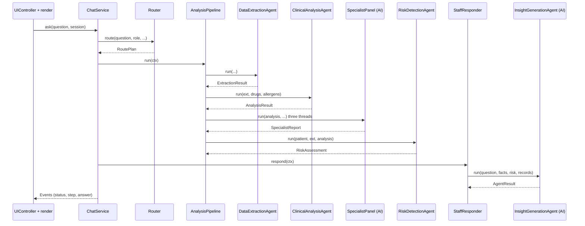

# ClinicalChat — Code Flow Walkthrough (for Python beginners)

> **Generated**: 2026-11-16 18:30 UTC+5:30
> **Updated**: 2026-11-16 18:30 UTC+5:30
> **Status**: Final
> **Audience**: you know basic Python (variables, functions, `if`, `for`, lists, dicts) and want to follow the real
> code, line by line, from `clinicalchat serve` to an agent's answer on the screen.

## Table of Contents
- [0. How to read this document](#0-how-to-read-this-document)
- [1. The Python you need (8 ideas, all taken from this code)](#1-the-python-you-need-8-ideas-all-taken-from-this-code)
- [2. The whole flow on one page](#2-the-whole-flow-on-one-page)
- [3. Part A — Start-up: from the command to a waiting server](#3-part-a--start-up-from-the-command-to-a-waiting-server)
- [4. Part B — Log-in and page load](#4-part-b--log-in-and-page-load)
- [5. Part C — One clinician question, end to end](#5-part-c--one-clinician-question-end-to-end)
- [6. Part D — Inside one AI agent call (`LLMAgent`)](#6-part-d--inside-one-ai-agent-call-llmagent)
- [7. Part E — A patient question: what is different](#7-part-e--a-patient-question-what-is-different)
- [8. Part F — The other doors into the same pipeline](#8-part-f--the-other-doors-into-the-same-pipeline)
- [9. Part G — Every agent: created where, called where, returns what](#9-part-g--every-agent-created-where-called-where-returns-what)
- [10. Part H — Follow it yourself (CLI, debugger, logs, Langfuse)](#10-part-h--follow-it-yourself-cli-debugger-logs-langfuse)
- [11. Glossary](#11-glossary)
- [Revision History](#revision-history)

Related: [CLASS_GUIDE.md](CLASS_GUIDE.md) (every class and its job) · [FILE_GUIDE.md](FILE_GUIDE.md) (every file) ·
[ARCHITECTURE.md](ARCHITECTURE.md) (diagrams) · [HOW_IT_WORKS.md](HOW_IT_WORKS.md) (no-code tour).

---

## 0. How to read this document

- `services/chat.py:71` means **file `src/clinicalchat/services/chat.py`, line 71**. In VS Code press
  `Ctrl+P`, type `chat.py:71` and press Enter to jump there.
- Code snippets are copied from the real files. `...` means "lines left out to keep it short".
- `A ▶ B` means "A calls B".
- 🤖 marks a step that calls OpenAI. Everything without 🤖 is ordinary Python that runs in milliseconds.

The example used all the way through Part C is real. Dr. Sharma (clinician) has patient **Ananya Rao** selected and asks:

> *"What do her kidney function results show?"*

---

## 1. The Python you need (8 ideas, all taken from this code)

You only need these eight ideas to follow the whole flow. Each one is shown with code from this project.

### 1.1 Classes, `__init__` and `self`

A **class** is a template for an object that keeps some data and has functions (called **methods**) that use it.
`__init__` runs once when the object is created and stores what the object needs on `self`.

```python
# services/router.py:88
class Router:
    def __init__(self, patients: PatientDirectory, kg: MedicalKnowledgeGraph):
        self.patients = patients      # stored on the object ...
        self.kg = kg

    def route(self, question, role, ...):
        named = self.patients.find_in_text(question)   # ... and used later by its methods
```

`router = Router(kb.patients, kb.kg)` creates the object; `router.route("...", ...)` calls a method on it.
Python passes `router` in as `self` automatically.

**Why it matters here:** no class in this project creates the objects it needs. They are **handed in** through
`__init__` ("dependency injection"). All the handing-in happens in one function, `build_container()` (Part A).
So the question "who calls this agent?" always has the same answer: *whoever received it in `__init__`*.

### 1.2 `@dataclass` — a class that just holds data

```python
# domain/conversation.py:53
@dataclass
class Event:
    kind: str                 # status | step | safety | guidance | partial | answer | case | blocked
    title: str = ""
    text: str = ""
    status: str = "done"      # pending | done
    key: str = ""
    data: Dict[str, Any] = field(default_factory=dict)
```

`@dataclass` writes the `__init__` for you, so `Event("status", "🧭 Routed", "...")` just works. This project uses
dataclasses to carry data between steps: `Event`, `ChatSession`, `Turn`, `RoutePlan`, `TurnContext`,
`PipelineRun`, `ExtractionResult`, `AnalysisResult`, `Container`.

### 1.3 `Enum` — a fixed list of names

```python
# domain/roles.py:21
class Role(str, Enum):
    PATIENT = "patient"
    CLINICIAN = "clinician"
    ...
```

`Role.CLINICIAN` is safer than typing the string `"clinician"` everywhere, because a typo becomes an error.
`AgentName` (`roles.py:28`) is the same idea for the agents.

### 1.4 Inheritance — a child class reuses its parent's code

```python
# agents/insight.py:27
class InsightGenerationAgent(LLMAgent):     # "is an" LLMAgent
    name = AgentName.INSIGHT
    output_model = InsightOutput
    text_field = "answer"

    def __init__(self, llm):
        super().__init__(llm, INSIGHT_PROMPT)  # run the parent's __init__

    def run(self, *, question, audience, ...):
        return self._invoke({...}, config)    # _invoke is written once, in the parent LLMAgent
```

All five AI agents (Insight, Patient Communication and the three course specialists) inherit from `LLMAgent`
(`agents/llm/base.py:47`). The parent does the hard part (call OpenAI, check the answer, retry, never crash). Each child
only says *which prompt*, *which answer shape* and *which model*.

### 1.5 Generators: `yield`, `yield from` and `Iterator[Event]` ⭐ the most important idea

A normal function **returns once**. A **generator** function contains `yield` and can hand back **many values, one at
a time**, pausing in between. This is how the chat shows "⏳ Data Extraction… ✅ done… ⏳ Clinical Analysis…" *live*,
while the agents are still working.

Toy example:

```python
def countdown():
    yield 3          # pause here, hand back 3
    yield 2          # next time, continue here
    yield 1

for n in countdown():    # the for-loop pulls one value at a time
    print(n)             # prints 3, 2, 1
```

`yield from other()` means "pass on everything `other()` yields, as if I had yielded it myself":

```python
# services/chat.py:124
def _case(self, ctx):
    ...
    yield from self.pipeline.run(ctx, on_analysed=self.staff.prefetch)   # all the pipeline's events
    yield from self.staff.respond(ctx)                                   # then all the responder's events
```

One more trick that this code uses a lot: a generator can also `return` a value at the end, and
`x = yield from g()` passes on all of `g()`'s events **and** stores what it returned in `x`:

```python
# services/communicator.py:37
com = yield from self.writer.write(...)   # the partial answers go to the screen; the final AgentResult lands in `com`
```

**Important:** a generator does **nothing** until someone loops over it. `self.c.chat.ask(message, session)` only
creates a "paused" generator. The code runs when `render()` loops over it (`web/chat_renderer.py:133`). So the
web layer **pulls** events, and each pull runs the agent code a little further.

The type hint `Iterator[Event]` on a function just means "this is a generator of `Event`s".

### 1.6 A dictionary of functions (instead of a long `if/elif`)

```python
# cli.py:32
return {"serve": _serve, "ingest": _ingest, "ask": _ask, "reset-patient": _reset_patient}[args.cmd](args)

# services/chat.py:68
self._handlers = {"status": self._status, "general": self._general, "explain": self._explain, "case": self._case}
...
yield from self._handlers[mode](ctx)      # chat.py:93 — pick the function by name, then call it
```

In Python a function is a value, so you can keep it in a dict, pass it to another function, or store it. The same
idea is used for **callbacks**: `pipeline.run(ctx, on_analysed=self.staff.prefetch)` hands the *function*
`prefetch` to the pipeline, which calls it later (`pipeline.py:86-87`).

### 1.7 `with` — "do this, and always clean up afterwards"

```python
# services/chat.py:78
with trace.step("router", input={...}) as span:
    plan = self.router.route(...)
    span.update(output=plan.as_dict())
# leaving the block closes the Langfuse "router" step, even if route() raised an error
```

You will also see `try: ... finally: ...` (`chat.py:85-95`): the `finally` part runs no matter what. That is how
every question is written to the audit log even when something fails.

### 1.8 Threads: doing several slow things at the same time

```python
# services/specialist_panel.py:85
futures = {key: self._pool.submit(agent.run, text, ...) for key, (agent, text) in jobs.items()}
for key, future in futures.items():
    result = future.result()      # wait for each one to finish
```

`ThreadPoolExecutor.submit(f, args)` starts `f(args)` in the background and immediately returns a **Future**
(a "ticket"). `future.result()` waits for that job and gives back its result. Three AI specialists started this
way take about as long as the slowest one, not the sum of all three. Used in three places:
`SpecialistPanel` (AI specialists), `WebEnrichment` (web search) and `InsightService` (patient-case summary in the
background).

### Also good to know

| You see | It means |
|---|---|
| `x: Optional[str] = None` | a **type hint**: "x is a string or None". Python ignores it at runtime; it helps you and the editor |
| `@property` | a method you read like a field: `ctx.is_patient` (no brackets) |
| `@staticmethod` | a method that does not use `self` |
| `@app.get("/health")` | a **decorator**: registers the function below as the handler for that web address |
| `prompt \| llm` | LangChain's "pipe": fill in the prompt, then send it to the model (Part D) |
| `**inputs`, `**variables` | "all the remaining keyword arguments, as a dict" |

---

## 2. The whole flow on one page

```text
START-UP (once)                                              see Part A
clinicalchat serve
 └▶ cli.main()                                   cli.py:29
     └▶ web.app.serve()                          web/app.py:96
         ├▶ container.get_container()            container.py:149
         │   └▶ build_container()                container.py:89   creates EVERY object, incl. all agents
         └▶ uvicorn.run(create_app(container))   web/app.py:102    web server waits for the browser

ONE QUESTION (every time you press Send)                     see Part C
browser "Send"
 └▶ UIController.respond_with_files()            web/controller.py:128
     └▶ UIController.respond()                   web/controller.py:116
         └▶ render( ChatService.ask() )          web/chat_renderer.py:126  ← loops over the events, updates the screen
             ChatService.ask()                   services/chat.py:71
              ├▶ Router.route()                  services/router.py:93     whose records? which type? allowed? which agents?
              ├▶ WebEnrichment.lookup_unknown_drugs()  web_enrichment.py:92  only for unknown medicine names
              └▶ ChatService._case()             services/chat.py:124
                  ├▶ AnalysisPipeline.run()      services/pipeline.py:43
                  │   ├▶ _extract ▶ DataExtractionAgent.run()        agents/extraction.py:67   📄 rules
                  │   ├▶ _analyse ▶ ClinicalAnalysisAgent.run()      agents/analysis.py:98     🔬 rules
                  │   │            ▶ StaffResponder.prefetch()       (callback: start web search early)
                  │   │            ▶ SpecialistPanel.run()           specialist_panel.py:77    🤖 x3 in parallel
                  │   └▶ _score   ▶ RiskDetectionAgent.run()         agents/risk.py:187        🚨 rules
                  └▶ StaffResponder.respond()    services/responders.py:55
                      └▶ InsightService.write()  services/insight_service.py:69
                          └▶ InsightGenerationAgent.run()            agents/insight.py:35      💡 🤖
                              └▶ LLMAgent._invoke() ▶ _call() ▶ (prompt | ChatOpenAI).invoke()
             finally ▶ TurnRecorder.finish()     services/turn_recorder.py:25  audit log + Langfuse
 └▶ UIController.after_turn()                    web/controller.py:153  refresh the side panel
```

The same flow as a sequence diagram:



---

## 3. Part A — Start-up: from the command to a waiting server

### A1. The command `clinicalchat` → `cli.main`

When the project is installed into `.venv` (`uv pip install --python .venv/bin/python -e ".[dev]"`, see the README), this line in `pyproject.toml:35` creates a `clinicalchat` command:

```toml
[project.scripts]
clinicalchat = "clinicalchat.cli:main"
```

So typing `clinicalchat serve` runs the function `main()` in `cli.py`.

### A2. `cli.main()` picks the sub-command

```python
# cli.py:29
def main(argv=None) -> int:
    args = _parser().parse_args(argv)          # "serve" -> args.cmd == "serve"
    logging.basicConfig(level=logging.WARNING)
    return {"serve": _serve, "ingest": _ingest, "ask": _ask, "reset-patient": _reset_patient}[args.cmd](args)

# cli.py:35
def _serve(_args) -> int:
    from clinicalchat.web.app import serve    # imported here so "ingest"/"ask" don't load the web libraries
    serve()
```

### A3. `web/app.py: serve()` builds everything, then starts the web server

```python
# web/app.py:96
def serve() -> None:
    import uvicorn
    logging.basicConfig(level=os.getenv("LOG_LEVEL", "INFO"))
    container = get_container()   # ← builds EVERYTHING (A4). Takes a few seconds: reads the dataset
    threading.Thread(target=warm_up, args=(container.llm, container.fast_llm), ...).start()  # open the OpenAI connection early
    uvicorn.run(create_app(container), host=container.settings.host, port=container.settings.port)  # A6
```

### A4. `get_container()` → `build_container()` — the starting class `Container`

```python
# container.py:149
def get_container() -> Container:
    global _CONTAINER
    with _LOCK:
        if _CONTAINER is None:
            _CONTAINER = build_container()   # only the first time; later calls reuse it
        return _CONTAINER
```

`build_container()` (`container.py:89`) is **the most important function to read**. It creates objects in the order
they depend on each other:

```python
# container.py:92-108 — infrastructure first
settings = settings or get_settings()                 # reads .env  (config.py)
repos = Repositories.on(Database(...))                # SQLite tables: users, cases, uploads, caches …
tracer = Tracer(settings)                             # Langfuse (or a no-op when keys are missing)
kb = KnowledgeBase.load(settings, persist=persist)    # dataset → catalogue, knowledge graph, vector index
kb.load_user_data(repos.users.all(), repos.facts.all(), repos.uploads.all())   # sign-ups + uploaded reports
install_cache(settings)                               # same prompt again → answer from SQLite, no OpenAI call
insight_llm    = llm or create_chat_model(settings, INSIGHT)      # gpt-4.1
fast_llm       = llm or create_chat_model(settings, FAST)         # gpt-4.1-mini
specialist_llm = llm or create_chat_model(settings, SPECIALIST)   # gpt-4.1-mini
audit = AuditLog(settings.audit_dir)
web = web or TavilySearch(settings, repos.web)

# container.py:110-115 — THE AGENTS ARE CREATED HERE
extraction = DataExtractionAgent(kb.catalog, kb.patients, kb.kg, kb.records)       # 📄 rules
analysis = ClinicalAnalysisAgent(kb.catalog, kb.patients, kb.kg, kb.safety)       # 🔬 rules
insight_agent = InsightGenerationAgent(insight_llm)                               # 💡 AI
communication_agent = PatientCommunicationAgent(fast_llm)                         # 💬 AI
specialists = SpecialistPanel(specialist_llm, enabled=settings.specialists_use_llm)   # 🧪🩻🛡️ AI (3 agents inside)

# container.py:117-131 — services receive the agents
router = Router(kb.patients, kb.kg)
pipeline = AnalysisPipeline(extraction, analysis, RiskDetectionAgent(), kb.patients, kb.safety, specialists)  # 🚨 created inline
insight = InsightService(insight_agent, kb.patients, kb.records, repos.feedback, repos.cases, repos.insights, specialists)
writer = AnswerWriter(communication_agent)
...
staff = StaffResponder(insight, enrichment, communicator)
patient = PatientResponder(insight, filer, communicator)
...
return Container(chat=ChatService(router, kb.patients, enrichment, pipeline, staff, patient, general, ...), ...)
```

Read it as a family tree: **`Container` → `ChatService` → (`Router`, `AnalysisPipeline`, `StaffResponder`,
`PatientResponder` …) → agents → models**. Every later "who calls X?" question is answered by finding where X was
passed in here.

> **How does each AI agent get its model?** `create_chat_model` (`infrastructure/llm/models.py:37`) chooses the model
> name and answer length by *purpose*, then creates `ChatOpenAI(model=..., temperature=0.0,
> response_format=json_object, ...)` (`models.py:46`). With no `OPENAI_API_KEY` it returns an
> `UnavailableChatModel` that raises a clear error when used, so the rule-based agents still work.

### A5. What `KnowledgeBase.load` builds (used by the agents later)

```python
# services/knowledge_base.py:26
self.catalog  = DocumentCatalog(documents)              # every report section, by patient and type
self.kg       = MedicalKnowledgeGraph(registry.all())   # drugs, allergens, conditions, symptoms, patients
self.patients = PatientDirectory(registry, self.kg, self.catalog, self._lock)
self.index.index(documents)                             # ChromaDB vector search
self.records  = RecordRetriever(self.catalog, index)    # "give me the text for these sections / this query"
self.safety   = SafetyChecker(self.kg, self.patients)   # allergy + drug-interaction checks
```

### A6. `create_app(container)` — the web app

```python
# web/app.py:34
app = FastAPI(title="ClinicalChat API", ...)
app.include_router(api_router(container))          # REST API: /api/query, /api/allergy/...  (Part F)
...
ui = build_ui(UIController(container), ...)         # the Gradio chat screen; UIController is its "brain"
return gr.mount_gradio_app(app, ui, path="/",
                           auth=container.accounts.authenticate, ...)   # login checked by AccountService
```

### A7. `build_ui` connects buttons to methods

`web/layout.py` draws the screen and says *"when this is clicked, call that method"*:

```python
# web/layout.py:110-111
msg.submit(ui.respond_with_files, send_inputs, send_outputs, concurrency_limit=4).then(ui.after_turn, session, post)
send.click(ui.respond_with_files, send_inputs, send_outputs, concurrency_limit=4).then(ui.after_turn, session, post)
```

Pressing **Enter** (`msg.submit`) or **Send** (`send.click`) calls `UIController.respond_with_files`. When it has
finished, `.then(...)` calls `UIController.after_turn`. `uvicorn` now waits on port 7860.

---

## 4. Part B — Log-in and page load

1. The browser opens `/`. Gradio shows the log-in form. The username and password go to
   `AccountService.authenticate` (`web/app.py:90`).
2. After log-in, `demo.load(on_load, ...)` (`web/layout.py:100`) calls `UIController.start(username)`
   (`web/controller.py:82`).
3. `start` looks up the persona (role, name, own patient) and creates the **`ChatSession`** (`controller.py:86`):

```python
s = ChatSession(username=persona.username, role=role, display_name=persona.display_name,
                own_patient=persona.patient_key,
                selected_patient=persona.patient_key or content.DEFAULT_PATIENT.get(role))
```

Gradio keeps this `ChatSession` for the browser tab and passes it into every later call as `session`. The role
comes from the **server-side** login, never from the browser, so a user cannot pretend to be a clinician.

---

## 5. Part C — One clinician question, end to end

Dr. Sharma, Ananya Rao selected: *"What do her kidney function results show?"*

### C1. Send → `UIController.respond_with_files` → `respond`

```python
# web/controller.py:128
def respond_with_files(self, message, history, session, attached):
    paths = [Path(p) for p in (attached or [])]
    if not paths:                                   # no 📎 files → normal chat question
        for out in self.respond(message, history, session):
            yield (*out, SKIP, SKIP, SKIP)
        return
    ...                                             # with files → UploadService (Part F)

# web/controller.py:116
def respond(self, message, history, session):
    ...
    yield from self._stream(render(self.c.chat.ask(message, session), message, history, session), session)
```

Line 126 is the key line. Read it from the inside out:

1. `self.c.chat.ask(message, session)` creates the **paused generator** of events (nothing runs yet).
2. `render(...)` (`web/chat_renderer.py:126`) loops over it. **That loop is what runs the agents.**
3. `_stream` hands each new chat picture to Gradio, which sends it to the browser.

### C2. `render()` — the loop that drives everything

```python
# web/chat_renderer.py:126
def render(events, user_text, history, session):
    turn = _Turn(session.role, user_text, history)
    session.busy = True
    yield turn.view()                      # show the question + "⏳ Starting…" at once
    try:
        for ev in events:                  # ← each step of this loop runs ChatService.ask() up to its next `yield`
            turn.handle(ev)                # turn the Event into chat messages / agent-strip colours
            yield turn.view()              # → browser
    except Exception as exc:
        turn.put(None, f"⚠️ Something went wrong: {exc}")
    finally:
        session.busy = False
    turn.finish()
    yield turn.view()
```

`_Turn.handle` (`chat_renderer.py:115`) picks a method by `ev.kind`: `status` updates the "🧠 Agent activity" list and
the coloured agent strip, `step` shows "🔎 What the agents found", `partial` shows text that is still being typed,
and `answer` shows the final answer.

### C3. `ChatService.ask` — the front door

```python
# services/chat.py:71
def ask(self, question, session):
    question = question.strip()
    yield Event("status", "🧭 Understanding your question", "Detecting the topic and checking access…", "pending", "route")
    context_patient = session.selected_patient or session.last_patient      # "ananya-rao-54"
    current = session.own_patient or context_patient
    has_insight = bool(session.last_insight and session.last_insight.get("patient_key") == current)
    trace = self.recorder.start(question, session)                           # Langfuse trace "chat-turn"
    with trace.step("router", input={...}) as span:
        plan = self.router.route(question, session.role, session_patient=context_patient,
                                 own_patient=session.own_patient, has_last_insight=has_insight)    # → C4
        span.update(output=plan.as_dict())
    ctx = TurnContext(question, session, plan, Turn(...), trace=trace)       # → C5
    yield routed_event(plan, self.patients)                                  # "🧭 Routed: Ananya Rao (54 F) …"
    try:
        if plan.blocked:
            ...
            yield Event("blocked", "🔒 Access", plan.blocked)               # e.g. radiologist asking for labs
        else:
            if plan.mode != "status":
                yield from self.web.lookup_unknown_drugs(ctx)                # → C6
            mode = "case" if plan.mode == "explain" and not has_insight else plan.mode
            yield from self._handlers[mode](ctx)                             # → C7: here "case" → self._case
    finally:
        self.recorder.finish(ctx)                                            # → C13 (always runs)
```

### C4. `Router.route` — no AI, just rules

```python
# services/router.py:93
def route(self, question, role, session_patient=None, own_patient=None, has_last_insight=False):
    role = Role(role)
    pol = policy(role)                                       # the role's rules from domain/roles.py POLICIES
    plan = RoutePlan()
    if not self._resolve_patient(plan, question, pol, session_patient, own_patient):
        return plan                                          # blocked: a patient asked about someone else
    plan.drugs = self.kg.resolve_drugs(question)             # medicine names  (knowledge graph)
    plan.allergens = self.kg.allergens_in_text(question)
    plan.symptoms = self.kg.symptoms_in_text(question)
    ...
    if not self._set_domains(plan, question, pol):           # "kidney function" → Domain.LAB; allowed for clinicians?
        return plan                                          # blocked: none of the asked record types is allowed
    plan.mode = self._mode(plan, question, pol)              # "case" | "general" | "explain" | "status"
    plan.agents = self._agents(plan, pol, has_last_insight)  # which of the 5 agents this turn will use
    return plan
```

- `_set_domains` (`router.py:143`) uses the regular expressions in `DOMAIN_PATTERNS` (`router.py:15`).
  "kidney function" matches the `Domain.LAB` pattern. It then keeps only the types in the role's `pol.domains`.
  The rest go into `plan.denied_domains`.
- `_agents` (`router.py:173`) returns `AGENT_ORDER` filtered by the role. For staff it drops Patient Communication
  (unless they ask "explain to the patient"). Result for our example:
  `[EXTRACTION, ANALYSIS, RISK, INSIGHT]`, shown as
  "📄 Data Extraction → 🔬 Clinical Analysis → 🚨 Risk Detection → 💡 Insight Generation".

### C5. `TurnContext` — the "backpack" carried through every step

```python
# services/turn.py:41
@dataclass
class TurnContext:
    question: str
    session: ChatSession
    plan: RoutePlan
    turn: Turn                          # what will be saved in the history / export
    run: PipelineRun = field(default_factory=PipelineRun)   # each agent puts its result in here
    trace: Span = NULL_SPAN             # Langfuse trace of this question

# services/turn.py:22
@dataclass
class PipelineRun:
    ext: Optional[ExtractionResult] = None     # ← filled by 📄 Data Extraction
    analysis: Optional[AnalysisResult] = None  # ← filled by 🔬 Clinical Analysis
    risk: Optional[RiskAssessment] = None      # ← filled by 🚨 Risk Detection
    llm: List[AgentResult] = ...               # ← every AI agent result (for the audit log)
    web_prefetch: Optional[Future] = None      # ← a web search started early
    ...
```

**This is how the agents "talk" to each other.** They never call each other directly. Each step reads what the
earlier steps put into `ctx.run` and adds its own result.

### C6. Unknown medicine names (only when there are any)

`WebEnrichment.lookup_unknown_drugs` (`services/web_enrichment.py:92`) looks for medicine-like words the knowledge
graph does not know (for example the brand "Dolo 650"). For each one it searches trusted drug sites with Tavily, finds
the ingredient (paracetamol) and adds it to `plan.drugs`, so the normal allergy checks also cover it. Our kidney
question has no medicine names, so this step yields nothing.

### C7. `ChatService._case` → the pipeline, then the responder

```python
# services/chat.py:124
def _case(self, ctx):
    if ctx.is_patient and ctx.plan.symptoms and ctx.patient_key:
        ctx.run.new_symptoms = self.symptoms.save(ctx.patient_key, ctx.plan.symptoms)
    if ctx.is_patient:
        yield from self.pipeline.run(ctx)                                  # Part E
        yield from self.patient.respond(ctx)
    else:
        yield from self.pipeline.run(ctx, on_analysed=self.staff.prefetch) # C8 – C11
        yield from self.staff.respond(ctx)                                 # C12
```

### C8. `AnalysisPipeline.run` — three steps in a fixed order

```python
# services/pipeline.py:43
def run(self, ctx, upload_doc_ids=(), on_analysed=None):
    yield from self._extract(ctx, upload_doc_ids)   # 📄
    yield from self._analyse(ctx, on_analysed)      # 🔬 (+ 🤖 AI specialists for staff)
    yield from self._score(ctx, upload_doc_ids)     # 🚨
```

**📄 Step 1 — Data Extraction** (`pipeline.py:56`)

```python
yield Event("status", f"{label} — gathering records", "...", "pending", "agent-extraction")   # strip turns ⏳
span = ctx.trace.child("data-extraction", as_type="agent", input={...})
with activate(span):
    ctx.run.ext = ext = self.extraction.run(ctx.question, ctx.session.role, plan.patient_key, plan.focus,
                                            new_symptoms=plan.symptoms, upload_doc_ids=upload_doc_ids)
...
yield Event("status", f"{label} — done", summary.split("\n")[0], "done", "agent-extraction")  # strip turns ✅
yield Event("step", label, summary, data={"agent": "extraction"})                            # findings card
```

Inside `DataExtractionAgent.run` (`agents/extraction.py:67`):
1. It drops any record type the role may not see (RBAC is checked a second time, `extraction.py:71-72`).
2. `_patient_records` (`extraction.py:85`) gets the patient's sections of the asked types from the `DocumentCatalog`.
3. `_focus` (`extraction.py:116`) keeps only the matching panel. "kidney" matches `LAB_PANELS`
   (`extraction.py:23`), so only the kidney panel is kept.
4. If nothing matches, `_related` (`extraction.py:124`) looks in the patient's other records (the thyroid fix).
5. It scores how well each section was read (`assess_section`) and lists missing data.

Returns an **`ExtractionResult`**. Real output: *"Selected 1 section(s) from the records: Kidney function test
sample zz.docx · extraction confidence HIGH"*.

**🔬 Step 2 — Clinical Analysis** (`pipeline.py:75`)

```python
ctx.run.analysis = an = self.analysis.run(ctx.run.ext, plan.drugs, plan.allergens,
                                          check_allergies=plan.check_allergies,
                                          allergy_record=Domain.ALLERGY in domains)
_knowledge_graph_span(span, an)
if on_analysed:
    on_analysed(ctx)                 # ← the callback = StaffResponder.prefetch (C9)
...
yield Event("status", f"{label} — done", ...)
yield Event("step", label, summary, ...)
if not ctx.is_patient:
    yield from self._ask_specialists(ctx, span, patient, domains)   # 🤖 (C10)
```

Inside `ClinicalAnalysisAgent.run` (`agents/analysis.py:98`), plain functions do all the work:
- `interpret_labs` (`agents/specialists/lab.py`) compares each value with its printed reference range and flags
  HIGH or LOW.
- `analyse_imaging` (`agents/specialists/radiology.py`) finds impressions and red-flag words in scan reports.
- `AllergySafety.check` (`agents/specialists/allergy.py`) uses the knowledge graph to check allergies,
  cross-reactions and drug interactions.
- `SymptomReasoner` (`agents/specialists/symptoms.py`) builds the symptom differential and checks for consistency.

Returns an **`AnalysisResult`**. Its `facts_text()` (`analysis.py:50`) turns the findings into the text that the AI
is later told it **must not contradict**. Real output: *"Lab Interpreter: 8 values checked, 7 outside the normal
range — BUN 28 mg/dL (high), Serum Creatinine 1.42 mg/dL (high) …"*.

### C9. The callback: start the web search early

```python
# services/responders.py:49
def prefetch(self, ctx):
    if wants_guidelines(ctx.question):                        # only if the question asks for guidelines/treatment
        ctx.run.web_prefetch = self.web.start("guideline", self._guideline_query(ctx), ctx)   # a Future (thread)
```

The search now runs **at the same time as** the AI specialists. `StaffResponder.respond` collects the result
later (C12). Our kidney question does not ask for guidelines, so nothing starts.

### C10. 🤖 The three course AI specialists, in parallel

```python
# services/pipeline.py:102
def _ask_specialists(self, ctx, span, patient, domains):
    panel, an = self.specialists, ctx.run.analysis
    if not (panel and panel.enabled and panel.jobs(an, patient, domains)):
        return                                                  # switched off, or nothing for them to read
    yield Event("status", ..., "Lab Interpreter / Radiology Analyzer / Allergy Safety (AI) are reviewing…", "pending", ...)
    an.ai = report = panel.run(an, patient, domains, span, ctx.llm_config)
    ...
    yield Event("step", f"{label} · AI specialists", specialists_text(report), ...)
```

```python
# services/specialist_panel.py:61
class SpecialistPanel:
    def __init__(self, llm, enabled):
        self.lab = LabInterpreterAgent(llm)            # 🧪
        self.radiology = RadiologyAnalyzerAgent(llm)   # 🩻
        self.allergy = AllergySafetyAgent(llm)         # 🛡️
        self._pool = ThreadPoolExecutor(max_workers=3, ...)

    def jobs(self, an, patient, domains):
        # only the specialists that (a) this role may use and (b) have a report to read
        ...

    def run(self, an, patient, domains, parent, llm_config):
        jobs = self.jobs(an, patient, domains) if self.enabled else {}
        ...
        futures = {key: self._pool.submit(agent.run, text, llm_config(spans[key])) for key, (agent, text) in jobs.items()}
        report = SpecialistReport()
        for key, future in futures.items():
            result = future.result()                 # wait for each thread
            self._record(report, key, result, spans[key])
        return report
```

Each `agent.run(text, config)` is `SpecialistAgent.run` (`agents/specialists/ai.py:182`), which calls
`self._invoke({"report": report}, config)`. That is the shared `LLMAgent` code in Part D. Here only the Lab
Interpreter had a report (labs only), so one AI call was made. In the real run it came from the cache
("🧪 Lab Interpreter (AI) cached answer"). The AI specialists can only *raise* the risk level, never lower it.

**🚨 Step 3 — Risk Detection** (`pipeline.py:119`)

```python
with ctx.trace.step("risk-detection", as_type="agent") as span:
    run.risk = risk = self.risk.run(self.patients.get(ctx.patient_key), run.ext, run.analysis)
yield Event("status", f"{label} — {risk.risk_level}", ...)        # "🚨 Risk Detection — MODERATE"
```

```python
# agents/risk.py:186
class RiskDetectionAgent:
    def run(self, patient, ext, an):
        return assessment([
            *lab_indicators(an.lab_results, patient.age if patient else None),   # panic values, thresholds
            *symptom_indicators(ext.symptoms, ext.new_symptoms),                 # red-flag symptoms
            *imaging_indicators(an.imaging),
            *medication_indicators(an.drug_alerts, an.medication_alerts),
            *(allergy_history_indicators(patient) if an.allergy_record_visible else []),
            *pattern_indicators(an.possible_conditions, an.inconsistencies, ext.quality.low_confidence),
            *ai_specialist_indicators(an),                                       # AI "urgent" flags
        ])
```

Every helper returns a list of `RiskIndicator`s. `assessment` (`risk.py:175`) takes the **most severe** one as the
overall level (LOW, MODERATE, HIGH or CRITICAL). Real output: *"Risk level 🟡 MODERATE · urgency soon · escalated
for clinician validation"*.

### C11. What the screen shows so far

Each `yield Event(...)` above went back through `ask()` → `render()` → the browser. So the clinician has already
seen the four status lines and three findings cards **before** any summary is written.

### C12. 💡🤖 `StaffResponder.respond` → `InsightService.write` → `InsightGenerationAgent.run`

```python
# services/responders.py:55
def respond(self, ctx):
    run, question = ctx.run, ctx.question
    yield Event("status", f"{INSIGHT} — writing", "Consolidating the findings (AI)…", "pending", "agent-insight")
    web = None
    if wants_guidelines(question):
        web = yield from self.web.search("guideline", ..., ctx, started=run.web_prefetch)   # collect the C9 search
    span = ctx.trace.child("insight-generation", as_type="agent", ...)
    ins = self.insight.write(question, policy(ctx.session.role).audience, ctx.patient_key, run,
                             ctx.session.history_text(), span, ctx.llm_config(span), web=web)
    end_agent_span(span, ins)
    run.llm.append(ins)
    run.review_reasons = review_reasons(run.ext, run.analysis, run.risk, ins)   # "Review Required" banner reasons
    yield Event("status", f"{INSIGHT} — {'failed' if ins.error else 'done'}", ins.timing(), "done", "agent-insight")
    _remember(ctx, out)                      # kept so "explain this to the patient" can reuse it
    md = render_insight(ins, run.review_reasons, run.ext.sources)              # presenters/answers.py → markdown
    ...
    yield Event("answer", INSIGHT, md, data={"agent": "insight", ...})        # ← the answer card on screen
```

```python
# services/insight_service.py:69
def write(self, question, audience, patient_key, run, history, span, config, web=None):
    ext, an = run.ext, run.analysis
    with activate(span):
        context = self.records.records_context(question, ext.sections, ext.focus)   # report text (+ vector search)
    if web and web.results:
        context += WEB_EVIDENCE_HEADER + web.context()
    return self.agent.run(question=question, audience=audience, patient=self.patients.summary(patient_key),
                          extraction=extraction_brief(ext), facts=an.facts_text(), risk=risk_brief(run.risk),
                          feedback=self.feedback.prompt_text(), context=context, history=history, config=config)
```

```python
# agents/insight.py:35
def run(self, *, question, audience, patient, extraction, facts, risk, feedback, context, history, config=None):
    return self._invoke({"system": INSIGHT_SYSTEM, "audience": audience, "question": question, "patient": patient,
                         "extraction": extraction, "facts": facts, "risk": risk, "feedback": feedback or "None.",
                         "context": context, "history": history or "None."}, config)        # → Part D
```

The **audience** text comes from the role's policy (`roles.py:79`). For a clinician it says "Give full technical
detail: exact values with reference ranges …". For a patient it says "plain, reassuring, simple language …". The
same agent writes differently for each role because of this one input.

### C13. `finally:` → `TurnRecorder.finish` — audit log + Langfuse

```python
# services/turn_recorder.py:25
def finish(self, ctx):
    ...
    session.turns.append(turn)                         # chat history (used by the next question and by Export)
    if plan.patient_key:
        session.last_patient = plan.patient_key
    self.audit.record({"user": ..., "role": ..., "patient": ..., "agents": ..., "risk_level": ...,
                       "llm_calls": ..., "cache_hits": ..., "latency_ms": ..., "trace_id": ...})   # data/audit/*.jsonl
    self._close_trace(ctx, latency_ms)                 # Langfuse: output + scores risk_level, review_required …
```

### C14. Back in the browser: `after_turn`

When the generator is finished, Gradio runs `.then(ui.after_turn, ...)` (`layout.py:110`). `after_turn`
(`controller.py:153`) refreshes the Export button, the patient card, "My case updates" and the review queues.

---

## 6. Part D — Inside one AI agent call (`LLMAgent`)

All five AI agents go through this code: Insight, Patient Communication, Lab Interpreter, Radiology Analyzer and
Allergy Safety.

### D1. Created once (from `build_container`)

```python
# agents/llm/base.py:52
def __init__(self, llm, prompt):
    self.llm = llm                       # the ChatOpenAI object from create_chat_model
    self.label = AGENT_LABELS[self.name] # "💡 Insight Generation"
    self.prompt = prompt                 # INSIGHT_PROMPT (agents/llm/prompts.py:34)
    self.chain = prompt | llm            # LangChain "pipe": fill in the prompt → send to the model
```

The prompt is a template with `{placeholders}`:

```python
# agents/llm/prompts.py:34
INSIGHT_PROMPT = ChatPromptTemplate.from_messages([
    ("system", "{system}\n\n{rules}\n\nAUDIENCE: {audience}\n\n"
               "Reply with ONE JSON object only — no text before or after — with these keys:\n{schema}"),
    ("human", "CONVERSATION SO FAR:\n{history}\n\nQUESTION:\n{question}\n\nPATIENT PROFILE:\n{patient}\n\n"
              "DATA EXTRACTION:\n{extraction}\n\nDETERMINISTIC FINDINGS (Clinical Analysis):\n{facts}\n\n"
              "RISK (Risk Detection):\n{risk}\n\nLESSONS FROM CLINICIAN REVIEWS:\n{feedback}\n\nRECORDS:\n{context}"),
])
```

### D2. Called: `_invoke` (one answer) and `_call` (with one retry)

```python
# agents/llm/base.py:58
def _inputs(self, variables):
    return {"rules": GROUND_RULES, "schema": schema_hint(self.output_model), **variables}   # fills {rules} and {schema}

# agents/llm/base.py:65
def _invoke(self, variables, config):
    start = time.perf_counter()
    result = AgentResult(agent=self.name, label=self.label)
    try:
        message = self._call(self._inputs(variables), self._config(config))        # 🤖 OpenAI
        result.cache_hit = bool((getattr(message, "response_metadata", None) or {}).get("cache_hit"))
        output, ok = self._parse(StrOutputParser().invoke(message))                # text → checked JSON
        result.output, result.parsed = output.model_dump(), ok
    except Exception as exc:                 # a backend failure must not crash the chat
        log.exception("%s failed", self.name.value)
        result.error = str(exc)[:400]
    result.latency_ms = int((time.perf_counter() - start) * 1000)
    return result

# agents/llm/base.py:79
def _call(self, inputs, cfg):
    try:
        return self.chain.invoke(inputs, config=cfg)     # prompt | ChatOpenAI  → one HTTPS request
    except Exception as exc:
        cap = getattr(self.llm, "max_tokens", None)
        if not (cap and _hit_length_limit(exc)):
            raise
        return (self.prompt | self.llm.bind(max_tokens=cap * 2)).invoke(inputs, config=cfg)   # answer was cut off → retry once with 2× room
```

Step by step:

| # | What happens | Where |
|---|---|---|
| 1 | Fill the template: system text, ground rules, the JSON keys expected, the findings | `_inputs` → `prompt` |
| 2 | Check the LangChain cache (same prompt before → stored answer, no OpenAI call) | `install_cache`, `infrastructure/llm/cache.py` |
| 3 | Send to OpenAI (`gpt-4.1` / `gpt-4.1-mini`, temperature 0, JSON mode) | `ChatOpenAI` (`models.py:46`) |
| 4 | Langfuse records the call, because `config` carries the Langfuse callback | `ctx.llm_config(span)` (`turn.py:59`) |
| 5 | Parse: find the JSON, fix small format slips (e.g. "80%" → 0.8), check it against the Pydantic model | `parse_output` (`agents/llm/output.py:55`) |
| 6 | Never crash: any error is put into `result.error` and shown as a friendly message | `except` in `_invoke` |

The result is always an **`AgentResult`** (`base.py:24`) with `output` (a dict such as `{"answer": ..., "key_findings":
[...], "confidence": 0.85, ...}`), `parsed`, `error`, `latency_ms` and `cache_hit`.

### D3. The answer shape (Pydantic model)

```python
# agents/insight.py:17
class InsightOutput(BaseModel):
    answer: str = Field(description="Direct answer to the question for the stated audience (markdown, 80-220 words)")
    key_findings: List[str] = ...
    possible_conditions: List[str] = ...
    next_steps: List[str] = ...
    additional_data_needed: List[str] = ...
    confidence: float = Field(default=0.7, ...)
    sources: List[str] = ...
```

`schema_hint(InsightOutput)` turns these fields and descriptions into the "reply with these keys" list inside the
prompt. The **same class** is used to check the reply. The three course specialists use LangChain's
`PydanticOutputParser` instead (`agents/specialists/ai.py:166`), as in the Week 4 notebook.

### D4. Streaming version: `_stream` (Patient Communication only)

`_stream` (`base.py:90`) does the same work with `self.chain.stream(...)`. It is a **generator**: while OpenAI is
still writing, it yields `("partial", {...})` about every 24 characters. At the end it yields
`("done", AgentResult)`. That is how a patient sees the answer appear word by word (Part E).

---

## 7. Part E — A patient question: what is different

Example: Ananya (patient) asks *"What does my kidney report mean?"*

### E1. Router

`_resolve_patient` (`router.py:116`) **forces** the patient's own record (`pol.own_record_only`). If she names
another patient, the question is blocked with the privacy message. `_mode` (`router.py:162`) chooses `"case"` because
the question is personal ("my"). A question like *"what is HbA1c?"* would be `"general"` and go to
`GeneralResponder` instead (Part F).

### E2. Same pipeline, but no AI specialists while she waits

`ChatService._case` calls `self.pipeline.run(ctx)` with no callback. In `_analyse`, `if not ctx.is_patient:` is
false, so **the specialists are skipped** for now. `_score` also yields a "🚦 What to do now" guidance card
(`pipeline.py:130-132`).

### E3. `PatientResponder.respond` — one AI call only

```python
# services/responders.py:90
def respond(self, ctx, upload_doc_ids=()):
    run, plan, key = ctx.run, ctx.plan, ctx.patient_key
    cached = None
    if key:
        run.evidence_fp = self.cases.evidence_fp(key, run.risk.risk_level)   # a "fingerprint" of the evidence
        run.file_case = self.cases.needs_case(ctx, upload_doc_ids)           # new report / symptom / asked for a doctor?
        if not (upload_doc_ids or run.new_symptoms or plan.drugs or plan.allergens):
            cached = self.insight.cached(key, run.evidence_fp)               # nothing changed → reuse old Insight
    ...
    background = bool(key and run.file_case and cached is None)
    yield self._insight_status(cached is not None, background)               # "💡 Insight — for the care team"
    basis = cached or self.insight.rule_based(ctx.question, run)             # NO AI: findings + record excerpt
    _remember(ctx, basis)
    yield from self.communicator.communicate(ctx, basis, run.risk.clinical_level, run.abnormal)   # 💬🤖 (E4)
    if background and ctx.turn.case_id:
        self.insight.in_background(ctx.turn.case_id, ctx, ctx.session.history_text())            # 💡🤖 in a thread (E6)
```

### E4. 💬🤖 `Communicator.communicate` → `AnswerWriter.write` → `PatientCommunicationAgent.stream` → `LLMAgent._stream`

This is a chain of four generators, each passing events up to the next:

```text
LLMAgent._stream               yields ("partial", dict) … ("done", AgentResult)        agents/llm/base.py:90
 ↑ PatientCommunicationAgent.stream   picks COMMUNICATION_SYSTEM / GENERAL_SYSTEM       agents/communication.py:32
 ↑ AnswerWriter.write          turns each partial into Event("partial"), runs the guard services/answer_writer.py:20
 ↑ Communicator.communicate    final guard check, then files the case               services/communicator.py:30
 ↑ PatientResponder.respond → ChatService._case → ChatService.ask → render() → browser
```

```python
# services/answer_writer.py:20
def write(self, title, config, abnormal, **inputs):
    result, paused = None, False
    for kind, value in self.agent.stream(config=config, **inputs):
        if kind == "done":
            result = value                                       # the final AgentResult
        elif not paused:
            md = communication_markdown(value)
            if blocking(check_patient_text([md], abnormal)):     # 🛡️ guard on EVERY partial text
                paused, md = True, PAUSED                        # stop showing text: "Checking the wording…"
            if md.strip():
                yield Event("partial", title, md + ("" if paused else CURSOR), ...)
    return result                                                # → `com = yield from self.writer.write(...)`
```

```python
# services/communicator.py:30 (shortened)
com = yield from self.writer.write(..., question=question, patient=self.patients.summary(ctx.patient_key),
                                   risk=f"{risk_level}: {PATIENT_GUIDANCE[risk_level]}", insight=json.dumps(insight)[:6000])
...
draft = communication_markdown(com.output or {})
issues = check_patient_text([draft], abnormal)                    # 🛡️ final guard (agents/guard.py:22)
guard_span(ctx.trace, draft, issues)                              # recorded in Langfuse as a "guardrail"
if not for_patient:                                               # staff "explain to the patient" → just a draft
    ...
md = patient_assessment_markdown(insight, level, draft, issues, reviewed=ctx.run.file_case)
if ctx.run.file_case:
    yield from self.cases.file(ctx, insight, level, draft, issues, md)    # E5
else:
    yield from self.cases.answer_doubt(ctx.patient_key, md)
```

The **guard** (`agents/guard.py`) uses plain regular expressions. It catches doses ("500 mg twice daily"), a
definitive diagnosis ("you have cancer"), "stop your medicine", and over-reassurance when results are abnormal.

### E5. `CaseFiler.file` — open or update the care-team case

`services/cases.py:58` saves the case in SQLite through `CaseRepository`. Its status (`domain/workflow.py`) decides
who sees it next: the radiologist first if there are unread scans, otherwise the coordinator. It then yields the
answer card and a "📁 Your case with the care team" card.

### E6. 💡🤖 The care-team Insight, in the background

```python
# services/insight_service.py:93
def in_background(self, case_id, ctx, history):
    ...
    def work():
        self._specialists_for_case(case_id, ctx)                      # 🧪🩻🛡️ now (for the care team)
        ins = self.write(question, audience, key, run, history, span, config)   # 💡 same write() as C12, clinician audience
        ...
        self.cache.save(key, run.evidence_fp, ins.output or {})      # next time: reused (E3 `cached`)
        self.cases.patch_payload(case_id, lambda p: wf.attach_insight(p, ins.output or {}))
    self._background.append(self._pool.submit(work))                  # start the thread; return immediately
```

`work` is a function defined **inside** a method. It is handed to a thread and runs after the patient already has
her answer. That is why patient answers take ~3.5 s instead of 20–30 s.

---

## 8. Part F — The other doors into the same pipeline

| Door | Entry point | Then | Agents |
|---|---|---|---|
| Chat with 📎 files | `UIController.respond_with_files` → `UploadService.upload_many` (`services/uploads.py:50`) | reads files in threads (`_read_all`), adds them to the `KnowledgeBase`, then the **same** `pipeline.run(ctx, upload_doc_ids=...)` + `patient.respond` / `staff.respond` (`uploads.py:106-111`) | all, focused on the new reports |
| Example chips | `chip.click(ui.respond, ...)` (`layout.py:113`) | identical to typing the text | as Part C / E |
| Patient general question | `ChatService._general` (`chat.py:109`) → `GeneralResponder.respond` (`responders.py:133`) | FAQ cache → Tavily health search → reference text → `AnswerWriter.write(general=True)` | 💬 only |
| Staff "explain to the patient" | `ChatService._explain` (`chat.py:116`) | reuses `session.last_insight`, calls `Communicator.communicate` | 💬 only (no new Insight) |
| "Where is my case?" | `ChatService._status` (`chat.py:104`) | reads the case table | none (no AI) |
| 🛡️ Allergy tile | `UIController.allergy_check` (`controller.py:164`) | `kg.allergy_safety_card(allergen)` | none (knowledge graph) |
| REST API | `POST /api/query` (`web/api.py:124`) | `container.chat.run(...)` = `list(chat.ask(...))` (`chat.py:97`), then `compose(events)` into JSON | as Part C / E |
| Terminal | `clinicalchat ask "..."` (`cli.py:58`) | `for ev in container.chat.ask(...)`: print each event | as Part C / E |
| Care-team buttons | `UIController.decide` (`controller.py`) → `CareTeamService` (`services/care_team.py`) | moves the case to the next status, saves the note and feedback | none; the Insight was already written in E6 |

So **`ChatService.ask` is the single front door**. Chat, chips, the API and the CLI all call it. Uploads use
`UploadService`, which reuses the same pipeline and responders.

---

## 9. Part G — Every agent: created where, called where, returns what

| Agent | AI? | Created in `build_container` | Called by | Method | Returns → stored in |
|---|---|---|---|---|---|
| 📄 `DataExtractionAgent` | no | `container.py:111` | `AnalysisPipeline._extract` (`pipeline.py:64`) | `.run(question, role, patient_key, focus, ...)` | `ExtractionResult` → `ctx.run.ext` |
| 🔬 `ClinicalAnalysisAgent` | no | `container.py:112` | `AnalysisPipeline._analyse` (`pipeline.py:82`) | `.run(ext, drugs, allergens, ...)` | `AnalysisResult` → `ctx.run.analysis` |
| 🧪 `LabInterpreterAgent` | 🤖 gpt-4.1-mini | inside `SpecialistPanel` (`container.py:115`, `specialist_panel.py:64`) | `SpecialistPanel.run` in a thread (`specialist_panel.py:85`) | `.run(report_text, config)` | `AgentResult` → `ctx.run.analysis.ai.lab` |
| 🩻 `RadiologyAnalyzerAgent` | 🤖 gpt-4.1-mini | same (`specialist_panel.py:65`) | same | same | → `.ai.radiology` |
| 🛡️ `AllergySafetyAgent` | 🤖 gpt-4.1-mini | same (`specialist_panel.py:66`) | same | same | → `.ai.allergy` |
| 🚨 `RiskDetectionAgent` | no | inline in `AnalysisPipeline(...)` (`container.py:119`) | `AnalysisPipeline._score` (`pipeline.py:123`) | `.run(patient, ext, analysis)` | `RiskAssessment` → `ctx.run.risk` |
| 💡 `InsightGenerationAgent` | 🤖 gpt-4.1 | `container.py:113` → `InsightService` | `InsightService.write` (`insight_service.py:77`), called by `StaffResponder.respond` or the background `work()` | `.run(question=..., audience=..., facts=..., ...)` | `AgentResult` → chat answer / case payload / insight cache |
| 💬 `PatientCommunicationAgent` | 🤖 gpt-4.1-mini, streamed | `container.py:114` → `AnswerWriter` | `AnswerWriter.write` (`answer_writer.py:23`), called by `Communicator` and `GeneralResponder` | `.stream(question=..., patient=..., risk=..., insight=...)` | `AgentResult` (after `partial`s) → answer / case draft |

Switches that change which agents run:

| Setting | Where | Effect |
|---|---|---|
| Role policy (`agents`, `domains`) | `domain/roles.py:70` `POLICIES` | which agents and record types each role gets |
| `SPECIALIST_AGENTS=auto\|llm\|rules` | `.env` → `config.py:47`, `specialists_use_llm` (`config.py:96`) | turns the three AI specialists on or off |
| `OPENAI_MODEL`, `OPENAI_FAST_MODEL`, `OPENAI_SPECIALIST_MODEL` | `.env` → `config.py` → `create_chat_model` | the model for each purpose |
| `LLM_CACHE` | `.env` → `install_cache` | reuse identical AI answers |
| `TAVILY_API_KEY` | `.env` → `TavilySearch.enabled` | web look-ups on or off |

---

## 10. Part H — Follow it yourself (CLI, debugger, logs, Langfuse)

### H1. Run one question in the terminal (no browser)

```bash
cd /home/launchpad/HealthCareProject/ClinicalChat
.venv/bin/clinicalchat ask "What do her kidney function results show?" --user dr.sharma --patient ananya-rao-54
```

This uses the same `ChatService.ask` and prints every event in order. Real output from this project:

```text
[..] 🧭 Understanding your question: Detecting the topic and checking access…
[ok] 🧭 Routed: **Patient:** Ananya Rao (54 F)
     **Pipeline:** 📄 Data Extraction → 🔬 Clinical Analysis → 🚨 Risk Detection → 💡 Insight Generation
[..] 📄 Data Extraction — gathering records: Selecting the relevant reports and checking quality…
[ok] 📄 Data Extraction — done: Selected 1 section(s) from the records: Kidney function test sample zz.docx · extraction confidence **HIGH**
[..] 🔬 Clinical Analysis — analysing: Checking values against reference ranges, imaging findings, allergies and symptoms…
[ok] 🔬 Clinical Analysis — done: - **Lab Interpreter:** 8 values checked, 7 outside the normal range — BUN 28 mg/dL (high), …
[..] 🔬 Clinical Analysis — AI specialists: Lab Interpreter / Radiology Analyzer / Allergy Safety (AI) are reviewing the reports…
[ok] 🔬 Clinical Analysis — done: AI specialists: 🧪 Lab Interpreter (AI) cached answer
[..] 🚨 Risk Detection — scoring: Applying safety rules…
[ok] 🚨 Risk Detection — MODERATE: Risk level **🟡 MODERATE** · urgency soon · **escalated for clinician validation**
[..] 💡 Insight Generation — writing: Consolidating the findings (AI)…
[ok] 💡 Insight Generation — done: 5.4s

=== 💡 Insight Generation ===
> 🟠 **Review Required** — Risk MODERATE — escalated for clinician validation
Ananya Rao's kidney function results indicate moderate chronic kidney disease (CKD), Stage 3. …
```

Every `[..]` / `[ok]` line is one `Event("status", ...)` from the code in Part C. Every `=== ... ===` block is an
`Event("step", ...)` or `Event("answer", ...)`.

### H2. Step through it in the VS Code debugger

Create `.vscode/launch.json` (or add this entry to it):

```json
{
  "version": "0.2.0",
  "configurations": [
    {
      "name": "ClinicalChat: ask one question",
      "type": "debugpy",
      "request": "launch",
      "module": "clinicalchat.cli",
      "args": ["ask", "What do her kidney function results show?", "--user", "dr.sharma", "--patient", "ananya-rao-54"],
      "cwd": "${workspaceFolder}",
      "python": "${workspaceFolder}/.venv/bin/python",
      "justMyCode": true
    }
  ]
}
```

Put breakpoints (click left of the line number) on these lines, press **F5**, then use **F10** (step over) and
**F11** (step into). Hover over a variable to see what it holds:

| # | Breakpoint | What to look at |
|---|---|---|
| 1 | `services/chat.py:79` `plan = self.router.route(...)` | step over, then hover `plan`: `mode`, `focus`, `agents` |
| 2 | `services/pipeline.py:64` `ctx.run.ext = ... self.extraction.run(...)` | after it: `ext.sections`, `ext.sources` |
| 3 | `services/pipeline.py:82` `... self.analysis.run(...)` | `an.abnormal`, `an.facts_text()` (type it in the Debug Console) |
| 4 | `services/specialist_panel.py:85` `futures = ...` | `jobs`: which specialists will run |
| 5 | `services/pipeline.py:123` `... self.risk.run(...)` | `risk.risk_level`, `risk.indicators` |
| 6 | `agents/llm/base.py:69` `message = self._call(...)` | `variables`: the exact text sent to OpenAI |
| 7 | `agents/llm/base.py:72` `result.output, ... = ...` | `output`: the checked JSON answer |
| 8 | `services/turn_recorder.py:33` `self.audit.record({...})` | the audit line that gets saved |

To debug the **web app** instead, use `"args": ["serve"]` and ask in the browser. Breakpoints stop the same way.
To debug a **patient** question, use `"--user", "ananya.rao"` and leave out `--patient`.

### H3. Where the run leaves traces

| What | Where | Written by |
|---|---|---|
| One JSON line per question (who, role, patient, agents, risk, AI calls, cache hits, latency, trace id) | `data/audit/*.jsonl` | `TurnRecorder.finish` → `AuditLog.record` |
| Server log (warnings, retries, errors) | `logs/server.log` | Python `logging` |
| Full step tree with inputs, outputs, timings, scores | Langfuse → Traces | `Tracer` / `Span` (`infrastructure/tracing.py`) |
| Chat export (markdown) | `data/exports/` | `SessionExporter` |

Langfuse span names map one-to-one onto the code:

```text
chat-turn                              TurnRecorder.start              services/turn_recorder.py:20
├─ router                              ChatService.ask                 services/chat.py:78
├─ data-extraction        (agent)      AnalysisPipeline._extract       services/pipeline.py:61
├─ clinical-analysis      (agent)      AnalysisPipeline._analyse       services/pipeline.py:79
│  ├─ knowledge-graph     (tool)       _knowledge_graph_span           services/pipeline.py:135
│  └─ 🧪 Lab Interpreter (AI) (agent)  SpecialistPanel.run             services/specialist_panel.py:83
│     └─ ChatOpenAI                    LangChain callback (automatic)
├─ risk-detection         (agent)      AnalysisPipeline._score         services/pipeline.py:122
└─ insight-generation     (agent)      StaffResponder.respond          services/responders.py:61
   └─ ChatOpenAI                       LangChain callback (automatic)
(patients:) patient-communication → patient-text-guard (guardrail)  services/communicator.py:35, observability.py:23
```

---

## 11. Glossary

| Word | Meaning in this project |
|---|---|
| **Agent** | a class with one job and a `run` / `stream` method. Three are plain rules, five call OpenAI |
| **Container** | the object that holds every service and agent; built once by `build_container()` |
| **Dependency injection** | objects receive what they need in `__init__` instead of creating it themselves |
| **Event** | one live update for the screen (`domain/conversation.py:54`) |
| **Generator** | a function with `yield` that hands back values one at a time (§1.5) |
| **RoutePlan** | the Router's decision: patient, record types, mode, agents, blocked? |
| **TurnContext / PipelineRun** | the "backpack" carried through one question; each agent stores its result in `ctx.run` |
| **AgentResult** | what every AI agent returns: `output`, `parsed`, `error`, `latency_ms`, `cache_hit` |
| **Span / trace** | a Langfuse record of one step / one question |
| **Domain** | a record type: lab, radiology, allergy, patient record, reference |
| **RBAC** | role-based access control: `POLICIES` in `domain/roles.py` |
| **LCEL `prompt \| llm`** | LangChain: fill in the prompt, then send it to the model |
| **Future** | a ticket for work running in another thread; `.result()` waits for it |

---

## Revision History

| Version | Date | Author | Changes |
|---------|------|--------|---------|
| v1.0 | 2026-11-16 | Copilot | Initial version: Python primer, start-up chain, clinician and patient question flows, `LLMAgent` internals, other entry points, agent table, debugging guide |
