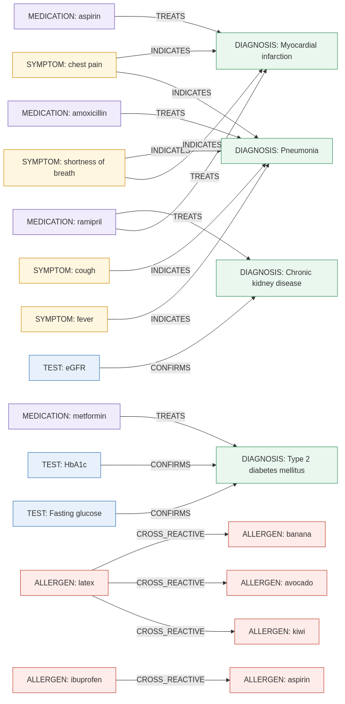

> **Generated**: 2026-11-16 15:30 UTC
> **Updated**: 2026-11-16 15:30 UTC
> **Project**: ClinicalChat — multi-agent clinical chatbot (HealthCare capstone)
> **Status**: Draft (pending local verification)

# Course alignment: Week 1–8 notebooks → ClinicalChat

The capstone notebooks (`Week-1 … Week-8 Assignment.ipynb`) build the system step by step in a notebook. ClinicalChat implements the same ideas as a layered application. This page lists, for every week, what the notebook asks for, where it lives in the code, and where we deliberately differ.

## Table of Contents
- [Summary](#summary)
- [Week 1 — Environment setup and data loading](#week-1--environment-setup-and-data-loading)
- [Week 2 — Document processing and entity extraction](#week-2--document-processing-and-entity-extraction)
- [Week 3 — ChromaDB vector store and embeddings](#week-3--chromadb-vector-store-and-embeddings)
- [Week 4 — Single agent design (the three specialists)](#week-4--single-agent-design-the-three-specialists)
- [Week 5 — Multi-agent orchestration and RBAC](#week-5--multi-agent-orchestration-and-rbac)
- [Week 6 — Medical knowledge graph](#week-6--medical-knowledge-graph)
- [Week 7 and 8 — Production system, observability, UI and deployment](#week-7-and-8--production-system-observability-ui-and-deployment)
- [Deliberate differences from the notebooks](#deliberate-differences-from-the-notebooks)
- [Switches](#switches)
- [Revision History](#revision-history)

---

## Summary

| Week | Course topic | ClinicalChat |
|------|--------------|--------------|
| 1 | Environment, Langfuse init, data loading | [`config.py`](../src/clinicalchat/config.py), [`infrastructure/tracing.py`](../src/clinicalchat/infrastructure/tracing.py), [`ingestion/loaders.py`](../src/clinicalchat/ingestion/loaders.py) |
| 2 | Document processing, entity extraction | [`ingestion/`](../src/clinicalchat/ingestion) (sectioning, lab tables, registry, OCR), 📄 Data Extraction agent |
| 3 | ChromaDB + embeddings | [`infrastructure/vector_index.py`](../src/clinicalchat/infrastructure/vector_index.py): OpenAI `text-embedding-3-small` (traced), local MiniLM fallback |
| 4 | Single agent: Lab Interpreter, Radiology Analyzer, Allergy Safety, Pydantic output | [`agents/specialists/ai.py`](../src/clinicalchat/agents/specialists/ai.py) + [`services/specialist_panel.py`](../src/clinicalchat/services/specialist_panel.py) |
| 5 | Multi-agent orchestration, role-based access | [`services/router.py`](../src/clinicalchat/services/router.py), [`services/pipeline.py`](../src/clinicalchat/services/pipeline.py), [`domain/roles.py`](../src/clinicalchat/domain/roles.py) |
| 6 | Medical knowledge graph | [`knowledge/graph.py`](../src/clinicalchat/knowledge/graph.py), [`knowledge/ontology.py`](../src/clinicalchat/knowledge/ontology.py), [diagram](diagrams/09-knowledge-graph.png) |
| 7–8 | Production system, Langfuse tracing and scores, Gradio UI, REST API, deployment | [`web/`](../src/clinicalchat/web), [`services/observability.py`](../src/clinicalchat/services/observability.py), [`deployment/`](../deployment) |

## Week 1 — Environment setup and data loading

| Course | Here |
|--------|------|
| `.env` with OpenAI / Langfuse keys | `.env` (git-ignored); template [`.env.example`](../.env.example). All keys optional — without OpenAI the app answers from the rule-based findings. |
| `Langfuse()` client, `@observe` | `Tracer` / `Span` wrapper over the Langfuse v5 SDK in `infrastructure/tracing.py`; a no-op tracer when keys are absent, so code never checks "is tracing on?". |
| Load the dataset folders | `ingestion/loaders.py` reads DOCX, PDF (OCR for scans), XLSX and TXT from `data/raw`. |

## Week 2 — Document processing and entity extraction

| Course | Here |
|--------|------|
| Split documents per patient, extract labs / findings / allergies | `ingestion/sectioning.py`, `ingestion/registry.py` (patient directory), `ingestion/lab_tables.py` (value, unit, reference range, status). |
| Lab status vs reference range | `lab_tables.py` uses the range printed on the report; **course panic values** (`CRITICAL_LIMITS`, e.g. Hb < 7 or > 20 g/dL, K⁺ < 2.5 or > 6.5 mEq/L, WBC < 2 or > 30 ×10³/µL) mark CRITICAL. |
| Re-processing after rule changes | `ingestion/corpus.py` stores `CORPUS_VERSION`; the parsed corpus is rebuilt automatically when it changes. |
| Entity extraction from uploads | 📄 Data Extraction agent + `ingestion/uploads.py` (classify, quality score, name check). |

## Week 3 — ChromaDB vector store and embeddings

| Course | Here |
|--------|------|
| `chromadb.PersistentClient`, collection, `OpenAIEmbeddingFunction` | `VectorIndex` in `infrastructure/vector_index.py`; `TracedOpenAIEmbeddingFunction` records every embedding call in Langfuse. |
| Metadata filters on search | Search is filtered by patient and by the record types (`domain`) the role may see. |
| Embedding model | `text-embedding-3-small` with an OpenAI key; otherwise the local all-MiniLM-L6-v2 (ONNX). Switching model re-indexes automatically (the model is stored with the index). |

## Week 4 — Single agent design (the three specialists)

The notebook's three agents are implemented **as in the notebook** — one LangChain call each, `PydanticOutputParser.get_format_instructions()`, and the course models field for field:

| Agent | Pydantic model | Sees |
|-------|----------------|------|
| 🧪 Lab Interpreter | `LabInterpretation` (test_name, result_value, status, clinical_significance, potential_causes, recommended_actions, urgency, confidence) | Lab values (abnormal first), demographics |
| 🩻 Radiology Analyzer | `RadiologyFinding` (study_type, body_region, findings, impression, differential_diagnoses, recommendations, urgency, confidence) | Up to 3 imaging studies |
| 🛡️ Allergy Safety | `AllergyAssessment` (allergen, category, severity, reactions, cross_reactivities, safe_alternatives, emergency_protocol, confidence) | Allergy record + knowledge-graph facts and alerts |

How they fit in:
- They run **inside step 2 (Clinical Analysis)**, in parallel, and only for the record types the asking role may see (a clinician never triggers the Radiology Analyzer).
- **Staff:** they run while the clinician waits (~4–5 s, in parallel with the guideline web search). **Patients:** they run in the background when a case is opened, so the patient's answer is not slower. Their output is attached to the case for the care team.
- The rule-based findings stay the safety net. AI urgency (`stat` / `emergency` → HIGH, `urgent` → MODERATE) can only **raise** the risk, never lower it.
- Each specialist is a child span in Langfuse with a `<agent>_confidence` score.

## Week 5 — Multi-agent orchestration and RBAC

| Course | Here |
|--------|------|
| Orchestrator routes the query to agents | `services/router.py` (keywords, no AI) → `services/pipeline.py` (📄 → 🔬 → 🚨) → responders (💡 / 💬). |
| Role-based access (which roles see which record types) | `domain/roles.py`, **hybrid** of the course table and our case workflow: |

| Role | Record types | Notes |
|------|--------------|-------|
| Patient | Own record only (all types) | Unchanged — patients see their own data. |
| Clinician | Lab, allergy, patient record, reference | As in the course; radiology hand-over notes on a case they are assigned stay visible. |
| Radiologist | Radiology, reference | As in the course; the iodinated-contrast **safety alert** is still shown when contrast is relevant. |
| Care coordinator | All | As in the course. |

A blocked request is answered without AI and recorded as an `rbac_blocked` score in Langfuse.

## Week 6 — Medical knowledge graph

| Course | Here |
|--------|------|
| Node types TEST, SYMPTOM, DIAGNOSIS, TREATMENT, ALLERGEN | Same vocabulary in `knowledge/graph.py` (plus MEDICATION, MEDICATION_CLASS, PATIENT). |
| Relations CONFIRMS, INDICATES, CROSS_REACTIVE, TREATS | Same names. Extra safety relations: BELONGS_TO, INTERACTS, CONTRAINDICATES. |
| `find_diagnoses_for_symptoms()`, `get_cross_reactive_allergens()` | Same method names on `MedicalKnowledgeGraph`. |
| Course facts (e.g. latex ↔ banana / avocado / kiwi, aspirin ↔ ibuprofen) | Added to `knowledge/ontology.py`; the existing allergy / interaction rules are unchanged (verified by a before/after comparison of every patient's alerts). |
| Visualise the graph | `kg.to_mermaid(only=…)` draws the diagram above. |
| Allergy lookup tool | **🛡️ Allergy Safety Check** tile in the UI and `GET /api/allergy/{allergen}`. |

## Week 7 and 8 — Production system, observability, UI and deployment

| Course | Here |
|--------|------|
| Trace every step | One Langfuse trace per chat turn (`chat-turn`) with spans: router, data-extraction (+ embedding, vector-search), clinical-analysis (+ knowledge-graph tool, AI specialists), risk-detection, insight-generation / patient-communication (+ guard), web search. Uploads (`report-upload`, `parse-report`, `index-reports`) and care-team actions (`care-team-action`) are traced too. |
| Scores | `insight_confidence`, `lab_interpreter_confidence`, `radiology_analyzer_confidence`, `allergy_safety_confidence`, `risk_level`, `review_required`, `rbac_blocked`. |
| Gradio UI | `web/layout.py` (persona log-in, role-specific queues, agent strip, live agent activity, Allergy Safety Check tile). |
| REST API | `web/api.py`: `GET /api/health`, `GET /api/status`, `POST /api/query`, `GET /api/allergy/{allergen}`; HTTP Basic with the same log-ins; Swagger at `/docs`. |
| Graceful shutdown | FastAPI lifespan: finishes background care-team work, then flushes Langfuse (verified with SIGINT during background work). |
| Deploy | [`deployment/`](../deployment): EC2 setup script, systemd unit (port 8000), pinned requirements, Docker alternative. See [deployment/README.md](../deployment/README.md). |

## Deliberate differences from the notebooks

| Notebook | ClinicalChat | Why |
|----------|--------------|-----|
| Every agent is an LLM call | Steps 1–3 are rules; AI specialists add opinions | Safety-critical checks must be explainable and instant; the rules are the safety net. |
| `gpt-4o-mini` for the specialists | `gpt-4.1-mini` by default | Measured on the same prompt: 4.5–4.9 s vs 11–14 s, same structured output. `OPENAI_SPECIALIST_MODEL=gpt-4o-mini` restores the course model. |
| One orchestrator call per question | Patients: one streamed AI call; Insight and specialists in the background | Patient answers in ~3 s. |
| Notebook state | SQLite (users, cases, caches), ChromaDB on disk, JSONL audit log | Survives restarts; multi-user. |

## Switches

| Setting | Values | Effect |
|---------|--------|--------|
| `SPECIALIST_AGENTS` | `auto` (default: on with an OpenAI key), `llm`, `rules` | `rules` turns the AI specialists off (rule-based analysis only). |
| `OPENAI_SPECIALIST_MODEL` | default `gpt-4.1-mini` | Model for the three specialists. |
| `SPECIALIST_MAX_TOKENS` | default 900 | Output cap per specialist. |
| `OPENAI_EMBEDDING_MODEL` | default `text-embedding-3-small` | Embedding model (local MiniLM without a key). |

---

## Revision History

| Version | Date | Author | Changes |
|---------|------|--------|---------|
| v1.0 | 2026-11-16 | Copilot | Initial mapping of the Week 1–8 notebooks to the code |
