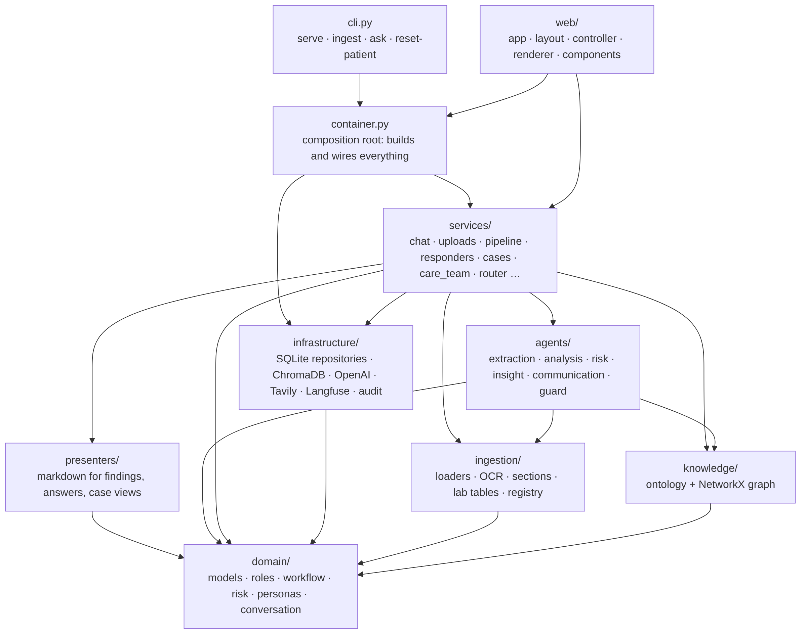

> **Generated**: 2026-11-16 04:21 UTC
> **Updated**: 2026-11-16 15:30 UTC
> **Project**: ClinicalChat — multi-agent clinical chatbot (HealthCare capstone)
> **Status**: Final

# File guide: every file, what it does, who calls it and how

This guide lists every file in the project. For each one it says:

- **What** the file does, in plain words.
- **Called by**: which files use it.
- **How**: the method or entry point those files use.

Read [ARCHITECTURE.md](ARCHITECTURE.md) for the diagrams. Read [HOW_IT_WORKS.md](HOW_IT_WORKS.md) for the plain-English story. Read [COURSE_ALIGNMENT.md](COURSE_ALIGNMENT.md) for how the Week 1–8 course notebooks map onto these files.

## Table of Contents
- [How to read the layers](#how-to-read-the-layers)
- [Entry points](#entry-points)
- [domain/ — the vocabulary](#domain--the-vocabulary)
- [knowledge/ — the medical knowledge graph](#knowledge--the-medical-knowledge-graph)
- [ingestion/ — reading clinical files](#ingestion--reading-clinical-files)
- [agents/ — the five agents](#agents--the-five-agents)
- [services/ — the use cases](#services--the-use-cases)
- [presenters/ — text shown in the chat](#presenters--text-shown-in-the-chat)
- [infrastructure/ — talking to the outside world](#infrastructure--talking-to-the-outside-world)
- [web/ — the web app](#web--the-web-app)
- [Tests](#tests)
- [Project and data files](#project-and-data-files)
- [Revision History](#revision-history)

---

## How to read the layers

Arrows point from a layer to the layers it uses. Nothing points back up.

- **domain/** has no dependencies. It holds the words of the system: patient, role, risk and case stage.
- **container.py** is the only file that *creates* objects. Every other class receives what it needs through its constructor (dependency injection).
- This is why the tests can swap OpenAI for a fake model with one argument: `build_container(llm=FakeLLM())`.

All paths below are relative to `src/clinicalchat/`.

---

## Entry points

| File | What it does | Called by | How |
|------|--------------|-----------|-----|
| `cli.py` | Terminal commands: `serve`, `ingest`, `ask`, `reset-patient`. | You, from the shell. `pyproject.toml` maps `clinicalchat` to `cli:main`. | `serve` → `web.app.serve()`. `ingest` → `load_corpus(rebuild=)` plus `VectorIndex.index(docs, force=True)`. `ask` → `get_container().chat.run()`. `reset-patient` → `PatientDataAdmin.purge(key, delete_login=)`. It refuses to run while the server is up. |
| `config.py` | Reads settings from environment variables and `.env`: keys, model names, folders and timeouts. | `container`, `cli`, and the infrastructure modules that need a key or a folder. | `get_settings()` returns one cached `Settings` object. |
| `container.py` | **Composition root.** Builds the database, repositories, knowledge base, AI models, agents and services, and connects them. | `web/app.py`, `web/controller.py`, `web/sidebar.py`, `cli.py`. Tests use `build_container(...)`. | `get_container()` returns a thread-safe singleton. `build_container(settings, kb=, llm=, web=, db_path=)` lets tests inject fakes. |
| `__init__.py` | Package marker and one-line description. | Python. | — |

---

## domain/ — the vocabulary

These are pure Python files. They do no I/O, make no AI calls and do not depend on any other layer.

| File | What it does | Called by | How |
|------|--------------|-----------|-----|
| `domain/models.py` | Shapes of the core data: `ClinicalDocument`, `Section`, `LabResult`, `PatientProfile`, `AllergyRecord`, `SafetyAlert`, `Domain` (lab / radiology / allergy / …). | Almost every layer: ingestion builds these objects; agents and services read them. | Pydantic models, created with `Model(...)`. |
| `domain/roles.py` | **RBAC.** The four roles, which agents each role may run, which record domains it may see (course table: clinician = lab + allergy + patient record; radiologist = radiology; coordinator = all; patient = own record) and the tone of its answers. Also the agent names and labels, including the three AI specialists. | Router, pipeline, specialist panel, responders, case views, the web layer and the API. | `policy(role)` returns a `RolePolicy`. `can_access_patient(...)` returns allowed or not. `AGENT_ORDER` lists the five pipeline agents. |
| `domain/workflow.py` | **Case stages and rules.** AWAITING_RADIOLOGY → AWAITING_TRIAGE → PENDING_REVIEW → VALIDATED / RETURNED. Also covers suggested priority, unread imaging and the patient stepper. | `services/cases.py` (first route), `services/care_team.py` (moves), the case repository, the web sidebar and controller. | Pure functions, for example `initial_status(...)`, `status_after_radiology(...)`, `status_after_patient_update(...)` and `stepper(case)`. |
| `domain/risk.py` | Risk levels LOW / MODERATE / HIGH / CRITICAL, their badges and the safety guidance shown to patients. | The Risk agent, presenters, the web components. | Constants plus `RiskAssessment`, `RiskIndicator`, `highest()` and `bump()`. |
| `domain/personas.py` | The demo log-ins (dr.sharma, dr.menon, dr.iyer, coord.thomas, ananya.rao, rahul.mehta, riya.das). | `services/accounts.py`, `services/care_team.py` (list of clinicians), the web content and layout. | `PERSONAS`, `clinicians()`, `self_registered()`. |
| `domain/conversation.py` | One chat session: `ChatSession` (who is logged in, history, last insight), `Turn` (one question and its answer) and `Event` (one live progress line streamed to the UI). | Services yield `Event`s; the web layer renders them. | Dataclasses. |
| `domain/privacy.py` | Removes names, IDs, dates and phone numbers before any text is sent to web search. | `infrastructure/web_search.py`. | `deidentify(text, names)`. |
| `domain/web_evidence.py` | One web result and a set of results. Formats them as `[W1]…` for the AI and as links for people. | Web search, `WebEnrichment`, `InsightService`. | `WebSearchOutcome.context()` and `.links_markdown()`. |
| `domain/clock.py` | Timestamp helpers. | Repositories, workflow. | `local_minute()`, `utc_minute()`. |

---

## knowledge/ — the medical knowledge graph

| File | What it does | Called by | How |
|------|--------------|-----------|-----|
| `knowledge/ontology.py` | Hand-curated medical facts. It covers:<ul><li>drugs and their classes;</li><li>allergen cross-reactivity (for example penicillin ↔ amoxicillin);</li><li>drug interactions and contraindications;</li><li>which symptoms and lab patterns point to which conditions.</li></ul> | `knowledge/graph.py`, which seeds the graph from it. The Lab specialist reads its lab-pattern table. | Constant dictionaries and lists. |
| `knowledge/graph.py` | `MedicalKnowledgeGraph` is a NetworkX graph using the course vocabulary (TEST ─CONFIRMS→ DIAGNOSIS, SYMPTOM ─INDICATES→ DIAGNOSIS, ALLERGEN ─CROSS_REACTIVE→ ALLERGEN, TREATMENT ─TREATS→ DIAGNOSIS) plus safety edges. Ontology nodes and patient facts (allergies, medicines, conditions) are joined by edges. The graph answers safety questions **without AI**. | `KnowledgeBase` builds it. Then:<ul><li>the Allergy and Symptom specialists, the Risk agent and `SafetyChecker` query it;</li><li>the Router uses it to spot drug names;</li><li>`WebEnrichment` adds web-found drugs to it;</li><li>the Allergy Safety Check tile and `GET /api/allergy/...` use its allergy card.</li></ul> | `check_drug_for_patient(drug, key)` returns alerts. Course queries: `find_diagnoses_for_symptoms(symptoms)`, `get_cross_reactive_allergens(allergen)`. Others: `differential(...)`, `resolve_drugs(text)`, `cross_reactive(allergen)`, `allergy_safety_card(allergen)`, `to_mermaid(only=)`. `add_patient(p)` / `refresh_patient(p)` update the graph. |

---

## ingestion/ — reading clinical files

The parsing runs once for the dataset. The result is cached in `data/processed/`. It runs again for every upload.

| File | What it does | Called by | How |
|------|--------------|-----------|-----|
| `ingestion/loaders.py` | Opens DOCX, PDF, XLSX, TXT and image files and returns text blocks and tables. Scanned PDF pages and photos go through **OCR** (RapidOCR). | `corpus.py`, `sectioning.py`, `uploads.py`. | `load_document(path)` returns a list of `Block`s. |
| `ingestion/sectioning.py` | One file can contain many patients. This module splits it into one `Section` per patient and picks out name, age, sex and dates. | `corpus.py`, `uploads.py`. | `split_sections(blocks, doc_title)`. |
| `ingestion/lab_tables.py` | Reads lab tables. The header row ('Result' + 'Reference range') may sit below the report banner (name, age, sample), and labels such as '1st Trimester' are not read as values. Each value is compared against its own printed reference range to get LOW / NORMAL / HIGH; the course panic values (`CRITICAL_LIMITS`) give CRITICAL. | `sectioning.py`, `uploads.py`. | `parse_lab_table(...)`, `compute_status(...)`. |
| `ingestion/registry.py` | Works out which sections belong to the same person (the patient key, for example `rahul-mehta-32`). Extracts allergies, medicines and conditions. | `corpus.py`, `KnowledgeBase`, `PatientDirectory`. | `PatientRegistry.build(documents)`, `extract_allergy(doc, section)`, `patient_key(name, age)`. |
| `ingestion/dates.py` | Parses report dates. Lab trends depend on them. | `corpus.py`, `uploads.py`. | `parse_date(...)`. |
| `ingestion/uploads.py` | One uploaded file becomes one `ClinicalDocument`. The module classifies it as lab, radiology or allergy, finds lab values even in free text and reads the printed patient name. Limit: 10 files per message. `reparse_generic_upload` re-reads lab values from a stored upload that was filed as a generic record (fixes reports saved by an older parser at start-up). | `UploadService`, the web controller (accepted file types, file limit), `KnowledgeBase.load_user_data`. | `parse_upload(path, patient_key=, patient_name=, ...)`, `reparse_generic_upload(doc)`, `foreign_name(doc, name)`, `MAX_UPLOAD_FILES`. |
| `ingestion/quality.py` | Gives each extraction a 0–1 score: how much we can trust what we read. Low scores are flagged for a clinician. | `UploadService` (per file), `DataExtractionAgent` (per question). | `assess_document(doc, name)`, `summarise_quality(...)`. |
| `ingestion/corpus.py` | Dataset ingestion: find files → load → split into sections → build the registry → save. | `cli ingest`, `KnowledgeBase.load()`. | `ingest(settings)`, `load_corpus(settings, rebuild=)`. |

---

## agents/ — the five agents

Agents 1–3 are **rule-based**: no AI, results in milliseconds. Agents 4–5 make **one OpenAI call** each. The three course AI specialists (`agents/specialists/ai.py`) add one call each, in parallel, inside step 2.

| File | What it does | Called by | How |
|------|--------------|-----------|-----|
| `agents/extraction.py` | **📄 Agent 1 – Data Extraction.** Chooses the records relevant to the question, within what the role may see, and scores how readable they are. A thyroid question finds a report by its test names (TSH / T3 / T4), not only by its title. When no report of the asked type exists, it uses other visible records that mention the test before saying "no data". | `AnalysisPipeline` (step 1). | `DataExtractionAgent.run(question, role, patient_key, focus, ...)` returns an `ExtractionResult`. |
| `agents/analysis.py` | **🔬 Agent 2 – Clinical Analysis.** Runs the four specialists below on the extracted records and merges what they find. Flags a "Clinical Inconsistency" when the symptoms don't match the reports. | `AnalysisPipeline` (step 2). | `ClinicalAnalysisAgent.run(ext, drugs, allergens, ...)` returns an `AnalysisResult`. |
| `agents/specialists/lab.py` | 🧪 Lab interpreter: lists abnormal values and matches lab patterns to possible conditions. | `analysis.py`. | `interpret_labs(results)`. |
| `agents/specialists/radiology.py` | 🩻 Radiology analyser: finds red flags (for example haemorrhage) and abnormal findings, and reads the impression. It understands negation, so "no fracture" is not counted as a fracture. | `analysis.py`, `risk.py`. | `analyse_imaging(section, source)`, `imaging_red_flags(text)`. |
| `agents/specialists/allergy.py` | ⚠️ Allergy safety: documented allergies plus knowledge-graph checks of every drug asked about or currently taken. | `analysis.py`. | `AllergySafety.check(patient, drugs, allergens)`. |
| `agents/specialists/symptoms.py` | 🤒 Symptom reasoner: works out which conditions could explain the symptoms, using the knowledge graph. | `analysis.py`. | `SymptomReasoner.differential(...)`, `.inconsistencies(...)`. |
| `agents/specialists/ai.py` | **Course AI specialists (Week 4):** 🧪 Lab Interpreter, 🩻 Radiology Analyzer, 🛡️ Allergy Safety. Each is one LangChain call whose answer is parsed with `PydanticOutputParser` into the course models `LabInterpretation`, `RadiologyFinding`, `AllergyAssessment`. `SpecialistReport` collects the three and maps AI urgency to a risk level (raise only). | `services/specialist_panel.py`; `agents/analysis.py` and `agents/risk.py` read the report from `AnalysisResult.ai`. | `LabInterpreterAgent(llm).run(report, config)` returns an `AgentResult`. `SpecialistReport.urgent()`, `.facts_lines()`. |
| `agents/risk.py` | **🚨 Agent 3 – Risk Detection.** Applies auditable rules to the findings and sets a level from LOW to CRITICAL. The rules cover:<ul><li>critical (panic) labs;</li><li>red-flag symptoms;</li><li>imaging red flags;</li><li>medicine alerts;</li><li>several conditions at once;</li><li>AI specialist urgency (can only raise the level).</li></ul>It also decides whether the case should be escalated to a clinician. | `AnalysisPipeline` (step 3). | `RiskDetectionAgent.run(patient, ext, analysis)` returns a `RiskAssessment`. |
| `agents/insight.py` | **💡 Agent 4 – Insight Generation (AI, gpt-4.1).** Writes a structured clinical summary for the care team: answer, key findings, next steps and confidence. | `InsightService`. | `InsightGenerationAgent.run(question=, patient=, facts=, risk=, ..., config=)`. |
| `agents/communication.py` | **💬 Agent 5 – Patient Communication (AI, gpt-4.1-mini, streamed).** Writes a plain-language answer for the patient. | `AnswerWriter`. | `PatientCommunicationAgent.stream(question=, patient=, risk=, insight=, ...)`. `communication_markdown(output)` formats the result. |
| `agents/guard.py` | 🛡️ Rule-based guard on every text a patient sees. It blocks doses, definitive diagnoses and "stop your medicine" advice. | `AnswerWriter`, `Communicator`, `GeneralResponder`. | `check_patient_text(parts, has_abnormal)` returns a list of issues. `blocking(issues)` says whether any of them must block the text. |
| `agents/llm/base.py` | Shared base for every AI agent (Insight, Communication and the three specialists). Each call is one LangChain call (prompt → model) that is timed, traced, retried and parsed. Errors are caught so the chat never crashes. | `insight.py`, `communication.py`, `specialists/ai.py`. | Subclass `LLMAgent`. Its `_invoke()` and `_stream()` produce an `AgentResult`; `_parse(text)` can be overridden (the specialists use the Pydantic parser). |
| `agents/llm/prompts.py` | The prompt text. To change how the AI behaves, you usually edit only this file. | `insight.py`, `communication.py`, `base.py`. | Constants. |
| `agents/llm/output.py` | Describes the JSON the AI must return and parses it leniently. | `base.py`. | `schema_hint(model)`, `parse_output(raw, model, text_field)`. |

---

## services/ — the use cases

Each service does one job. The container creates every service once; the web controller calls it.

| File | What it does | Called by | How |
|------|--------------|-----------|-----|
| `services/chat.py` | **ChatService** answers one chat message. Steps:<ol><li>Route the message.</li><li>Look up any unknown medicine on the web.</li><li>Hand off to one of four mode handlers: status / general / explain / case.</li></ol>`SymptomRecorder` saves the symptoms a patient mentions. | `UIController.respond`, `cli ask`. | `chat.ask(question, session)` yields `Event`s. `chat.run(...)` returns the same events as a list. |
| `services/router.py` | **Router.** Uses keywords only (no AI) to decide:<ul><li>the mode;</li><li>which record domains the question is about, filtered by RBAC;</li><li>which patient it is about;</li><li>which drugs, allergens and symptoms are mentioned.</li></ul> | `ChatService`, `UploadService`. | `router.route(question, role, ...)` returns a `RoutePlan`. |
| `services/pipeline.py` | **AnalysisPipeline** runs agents 1 → 2 → 3, emitting a live progress line and a Langfuse span for each (with the knowledge graph as a tool span). For staff it also asks the AI specialists in step 2. An `on_analysed` hook lets the caller start independent work (the guideline web search) as soon as the rule-based findings are ready. | `ChatService._case`, `UploadService`. | `pipeline.run(ctx, upload_doc_ids=, on_analysed=)` yields events and fills in `ctx.run`. `pipeline.safety_banner(ctx)`. |
| `services/specialist_panel.py` | **SpecialistPanel** runs the course AI specialists in parallel (up to 3 threads), only for the record types the role may see and the data the patient has. It builds each specialist's input (abnormal labs first, up to 3 imaging studies, the allergy record with knowledge-graph facts), records a child span and a confidence score per specialist. Switched by `SPECIALIST_AGENTS`. | `AnalysisPipeline` (staff), `InsightService` (patients, background). | `panel.jobs(an, patient, domains)`, `panel.run(an, patient, domains, parent_span, llm_config)` returns a `SpecialistReport`. |
| `services/responders.py` | Decides who writes the answer after step 3:<ul><li>**StaffResponder**: Insight runs while the clinician waits, with web guidelines if they were asked for (the search is started early by `prefetch`, in parallel with the AI specialists).</li><li>**PatientResponder**: one AI call. Insight is reused, or written in the background.</li><li>**GeneralResponder**: FAQ cache → web → reference material → answer.</li></ul> | `ChatService`, `UploadService`. | `respond(ctx)` yields events. `StaffResponder.prefetch(ctx)`. |
| `services/communicator.py` | Step 5 for a case:<ol><li>Write the patient answer.</li><li>Check it with the guard.</li><li>Ask `CaseFiler` to open or update the case if one is needed.</li></ol> | `PatientResponder`, `StaffResponder` ("explain to the patient"), `ChatService._explain`. | `communicate(ctx, insight, level, abnormal)`. |
| `services/answer_writer.py` | Streams the Communication agent's words into the chat. Each partial answer passes through the guard. | `Communicator`, `GeneralResponder`. | `writer.write(title, session, abnormal, **inputs)` yields events and returns the result. |
| `services/insight_service.py` | Runs Agent 4 at the right time:<ul><li>for staff, immediately;</li><li>for patients, in a background thread once a case exists — after first running the AI specialists for the case and attaching their findings (and any urgent flags as review reasons).</li></ul>Results are cached per patient and "evidence fingerprint". Past clinician notes are added to the prompt (learning from feedback). On shutdown `drain()` waits for background work. | `StaffResponder`, `PatientResponder`, `web/app.py` (lifespan). | `write(...)`, `in_background(case_id, ...)`, `cached(key, fp)`, `rule_based(...)`, `drain(timeout)`. |
| `services/cases.py` | **CaseFiler** keeps **one** open case per patient. It decides whether a case is needed:<ul><li>yes: new reports or symptoms, the patient asks for a doctor, or a clinician asked for more information;</li><li>no: a simple question.</li></ul>It then routes the case to the radiologist or the coordinator. | `PatientResponder`, `Communicator`. | `needs_case(ctx, uploads)`, `file(ctx, insight, level, draft, issues, md)`, `evidence_fp(...)`. |
| `services/care_team.py` | The care team's actions:<ul><li>radiology read;</li><li>triage (priority plus clinician);</li><li>clinician approve or return.</li></ul>Also provides the work queues, and the delivery of approved messages to the patient. | `UIController` (`decide`, `_act`, `poll`), the `Sidebar`. | `radiology_read(...)`, `triage(...)`, `review(...)`, `case(id)`, `list(status=, patient_key=)`, `undelivered(key)`, `mark_delivered(id)`. |
| `services/uploads.py` | **UploadService** handles report uploads:<ol><li>Check the role and the patient.</li><li>Read the files in parallel.</li><li>Accept or reject each file: duplicate, or someone else's name.</li><li>Save and index the accepted ones.</li><li>Run **one** pipeline over all of them, then answer and file the case.</li></ol> | `UIController.respond_with_files`. | `upload_many(files, session, message)` yields events. |
| `services/web_enrichment.py` | **WebEnrichment** uses Tavily for three jobs:<ul><li>general health answers for patients;</li><li>guideline evidence for staff;</li><li>unknown-drug look-up, after which the drug is added to the graph so allergy checks work.</li></ul>Time-boxed: it never blocks the chat for long. | `ChatService`, `StaffResponder`, `GeneralResponder`. | `start(kind, query, ctx)` begins a search in the background; `search(kind, query, ctx, wait=, started=)` waits for it (or starts one); `lookup_unknown_drugs(ctx)`. |
| `services/knowledge_base.py` | **KnowledgeBase** is everything the app knows, in memory. It keeps the catalog, the patient directory, the knowledge graph, the vector index, the records and the safety checker in sync. At start-up it reloads uploads and re-reads any that were filed as generic records but contain lab values. | `container` (built once), `UploadService` (adds new documents), `cli`. | `KnowledgeBase.load(settings)`, `add_document(doc)`, `load_user_data(...)`, `purge_uploads(key)`. |
| `services/catalog.py` | `DocumentCatalog`: every document and section, from the dataset and from uploads, looked up by ID. | `KnowledgeBase`, the agents, `CaseFiler`. | `patient_sections(key, domains)`, `sections_for(section_ids)`, `source_of(section)`. |
| `services/patients.py` | `PatientDirectory`:<ul><li>patient profiles (dataset and self-registered);</li><li>finding a patient by name;</li><li>the summary given to the AI;</li><li>the allergy text.</li></ul> | Router, agents, responders, web components. | `get(key)`, `find_in_text(text)`, `summary(key)`, `allergy_text(key)`. |
| `services/records.py` | `RecordRetriever` builds the compact record text the AI reads: the selected sections plus a little reference material from ChromaDB, at most 9000 characters. | `DataExtractionAgent`, `InsightService`, `GeneralResponder`. | `records_context(...)`, `search_sections(...)`, `reference_context(query)`. |
| `services/safety.py` | `SafetyChecker` checks medicines against allergies, cross-reactivity and interactions, using the knowledge graph. | The Allergy specialist, the pipeline (safety banner), `CaseFiler`. | `alerts(key, drugs)`, `contrast_alerts(key)`. |
| `services/turn.py` | `TurnContext` and `PipelineRun` hold everything one question carries through the services: the question, the session, the plan and each step's result. | Every service in the chat path. | Dataclasses passed as `ctx`. |
| `services/turn_recorder.py` | Starts and ends a turn: opens its Langfuse trace (`chat-turn` / `report-upload`), saves the turn (with its trace ID) to the session history, scores RBAC blocks and writes one audit line. | `ChatService`, `UploadService`. | `recorder.start(question, session, name=)`, `recorder.finish(ctx)`. |
| `services/observability.py` | Small helpers that turn an agent result into Langfuse data: ends the agent span with its output, tokens and errors and adds a `<agent>_confidence` score; records the patient-text guard as a guardrail span. | Responders, `Communicator`, `SpecialistPanel`, `InsightService`. | `end_agent_span(span, result)`, `guard_span(parent, text, issues)`. |
| `services/accounts.py` | Log-ins. Demo personas share one demo password; self-registered patients are stored with PBKDF2 hashing. | `web/app.py` (the Gradio auth callback and `/signup`). | `authenticate(user, pw)`, `signup(...)`, `get_persona(user)`. |
| `services/admin.py` | Wipes one patient's stored data: uploads, facts, cases, notes, cached insight and exports. | `cli reset-patient`. | `find_user(...)`, `summary(key)`, `purge(key, delete_login=)`. |
| `services/export.py` | Exports a chat session as a Markdown care summary. | `UIController` (Export button), `cli`. | `SessionExporter.export(session)`. |

---

## presenters/ — text shown in the chat

These are pure functions: results go in, Markdown comes out. No I/O and no AI.

| File | What it does | Called by | How |
|------|--------------|-----------|-----|
| `presenters/findings.py` | One-line summaries of what agents 1–3 and the AI specialists found. They are shown in the live activity log and fed to the AI prompts. | `ChatService`, `AnalysisPipeline`, `InsightService`, `case_views.py`. | `route_text`, `extraction_text`, `analysis_text`, `risk_text`, `specialists_text(report, show=)`. |
| `presenters/answers.py` | The final answer blocks: the staff insight, the patient assessment, the safety banner and the footers. | `Responders`, `Communicator`, `CaseFiler`, `Pipeline`. | `render_insight(...)`, `patient_assessment_markdown(...)`, `safety_banner(...)`. |
| `presenters/case_status.py` | The answer to a patient's "where is my case?". It is built from the case stages, with no AI. | `ChatService._status`. | `case_status_markdown(cases)`. |
| `presenters/case_views.py` | How a case looks to each care-team role:<ul><li>the radiologist sees the imaging, the Radiology Analyzer's opinion and the contrast-safety alert;</li><li>the coordinator sees a triage summary with all AI specialist opinions;</li><li>the clinician sees the findings, the Lab Interpreter and Allergy Safety opinions and the radiology hand-over.</li></ul> | `UIController.open_case`. | `CASE_VIEW[role](case, patient_label)`. |
| `presenters/allergy.py` | The Allergy Safety Check card: cross-reactive allergens, medicines to avoid and usually-safe alternatives, from the knowledge graph. | `UIController.allergy_check`. | `allergy_card_markdown(card, known_allergens)`. |

---

## infrastructure/ — talking to the outside world

| File | What it does | Called by | How |
|------|--------------|-----------|-----|
| `infrastructure/database.py` | One SQLite file and one schema. Writes are thread-safe. | `container`, all repositories. | `Database(path)`: `execute`, `rows`, `transaction()`. |
| `infrastructure/repositories/users.py` | Self-registered patient log-ins. | `AccountService`, `PatientDataAdmin`. | `create(...)`, `get(username)`, `check_password(...)`. |
| `infrastructure/repositories/patient_facts.py` | What patients said about themselves: symptoms, allergies and medicines. | `SymptomRecorder`, `AccountService`, `CaseFiler`, admin. | `add(key, kind, value)`, `all(key)`. |
| `infrastructure/repositories/uploads.py` | Uploaded reports, stored as parsed JSON with their quality score. | `UploadService`, `CaseFiler`, admin. | `save(...)`, `all(key)`. |
| `infrastructure/repositories/cases.py` | Care-team cases. Each row has a JSON payload and a timeline. | `CaseFiler`, `CareTeamService`, `ChatService`, `InsightService`. | `create`, `update`, `open_case(key)`, `list(...)`, `consolidate_open_cases()`. |
| `infrastructure/repositories/feedback.py` | Clinician review notes. They are added to later Insight prompts. | `CareTeamService`, `InsightService`. | `add(...)`, `prompt_text(limit)`. |
| `infrastructure/repositories/caches.py` | Three caches that save time and money:<ul><li>`InsightCache`: the latest insight per patient;</li><li>`FaqCache`: answers to general questions;</li><li>`WebCache`: Tavily results, kept for 7 days.</li></ul> | `InsightService`, `GeneralResponder`, `TavilySearch`. | `InsightCache.get/save`, `FaqCache.lookup/save`, `WebCache.lookup/save`. |
| `infrastructure/vector_index.py` | **ChromaDB** index of report passages. Embeddings: OpenAI `text-embedding-3-small` with a key (each call is a Langfuse `embedding` span), otherwise the local MiniLM (ONNX fallback when HuggingFace is unreachable). Changing the model rebuilds the index. Search is a `vector-search` retriever span, filtered by patient and by the record types the role may see. | `KnowledgeBase`, `RecordRetriever`, `cli ingest`. | `index(documents)`, `add_document(doc)`, `search(query, k, domains=, patient_key=)`. |
| `infrastructure/llm/models.py` | Creates the OpenAI models for each purpose: `INSIGHT` (gpt-4.1), `FAST` (gpt-4.1-mini, patients) and `SPECIALIST` (gpt-4.1-mini, the course specialists). Without a key it returns an "unavailable" model, so answers fall back to the rule-based ones. | `container`, `web/app.py` (warm-up), `/api/status`. | `create_chat_model(settings, purpose)`, `warm_up(...)`, `describe_llm(settings)`. |
| `infrastructure/llm/cache.py` | A SQLite cache of LLM responses, so an identical prompt is never paid for twice. | `llm/models.py`. | `install_cache(settings)`. |
| `infrastructure/web_search.py` | Tavily client. It searches trusted medical sites only (WHO, NHS, CDC, MedlinePlus, …) and de-identifies the query first. | `WebEnrichment`. | `TavilySearch.search(query, kind, names, config)` returns a `WebSearchOutcome`. |
| `infrastructure/tracing.py` | Optional **Langfuse** tracing (v5 SDK). `Tracer.trace(...)` opens one trace per turn, upload or care-team action; `Span.child / step / end / score` build the tree of agent, tool, retriever, embedding and guardrail observations; `langchain_config()` attaches LLM calls to the current span. A no-op tracer is used without keys. | `container`, `TurnRecorder`, pipeline, responders, `SpecialistPanel`, `VectorIndex`, `WebEnrichment`, `CareTeamService`, `web/app.py` (shutdown). | `tracer.trace(name, user_id=, session_id=, tags=)`, `span.child(...)`, `activate(span)`, `tracer.shutdown()`. |
| `infrastructure/audit_log.py` | Always-on audit trail: one JSON line per question, upload and care-team action, in `data/audit/`. | `TurnRecorder`, `CareTeamService`. | `audit.record(event)`. |

---

## web/ — the web app

| File | What it does | Called by | How |
|------|--------------|-----------|-----|
| `web/app.py` | The FastAPI app. It provides `/health`, the logo and `/signup`, includes the REST API (`/api/*`, Swagger at `/docs`), and mounts the Gradio chat at `/` behind the log-in. Its lifespan waits for background care-team work and flushes Langfuse on shutdown. | `cli serve`. | `create_app(container)`, `serve()` (warm-up thread, then uvicorn on `PORT`, default 7860). |
| `web/api.py` | **REST API** (course Week 8) with HTTP Basic log-in (same users as the UI): `GET /api/health`, `GET /api/status`, `POST /api/query` (runs the same `ChatService` as the chat and returns the answer, risk, agents and trace ID), `GET /api/allergy/{allergen}`. API conversations are kept per user and `session_id` (follow-ups work). | `web/app.py` (`include_router`). | `api_router(container)`. |
| `web/layout.py` | Places every Gradio component on the page and connects each button or event to a `UIController` method. It contains **no logic**. | `web/app.py`. | `build_ui(ui, llm_label, auth_enabled)`. |
| `web/controller.py` | **UIController**: one method per UI action. Each method calls **one** service and returns component updates. Examples: `respond`, `respond_with_files`, `open_case`, `decide`, `poll`, `allergy_check` (traced knowledge-graph look-up). It also contains the attachment-chip helpers. | `web/layout.py` (event wiring). | Gradio calls these methods. |
| `web/chat_renderer.py` | Turns the stream of `Event`s into chat bubbles: the live "Agent activity" log, the findings, the answers and the agent strip. | `UIController._stream`. | `render(events, user_text, history, session)` yields `(history, strip)`. |
| `web/sidebar.py` | What each role sees in the sidebar: patient card, "my cases", work queue and coordinator board. | `UIController`. | `Sidebar(container)`: `.patient_card(session)`, `.queue(session)`, `.board()`. |
| `web/components.py` | Small HTML builders: header, patient card, case cards, queue options, board and agent strip. Data goes in, HTML comes out. | Controller, sidebar, layout, renderer. | Pure functions. |
| `web/content.py` | Fixed UI text: example questions, welcome messages per role, the persona table on the log-in page and queue labels. | Layout, controller, app. | Constants plus `welcome(persona)` and `login_message()`. |
| `web/theme.py` | CSS and a script that forces the light theme. | `web/app.py`, `web/layout.py`. | Constants. |
| `web/signup_page.py` | A plain HTML sign-up form for new patients. | `web/app.py` (`GET/POST /signup`). | `render_form(...)`, `render_done(...)`. |
| `web/assets/*.svg` | The logo. | `web/app.py` (`/logo.svg`). | Static file. |

---

## Tests

Run them with `.venv/bin/pytest -q`. There are 112 tests. They use no network: a `FakeLLM` replaces OpenAI and `NoWeb` replaces Tavily.

| File | What it checks |
|------|----------------|
| `tests/conftest.py` | Shared fixtures:<ul><li>`kb`: the real dataset, loaded once;</li><li>`fake_llm`;</li><li>`make_container()`: a full container on a temporary database;</li><li>`repos`.</li></ul> |
| `tests/test_chat_service.py` | End-to-end chat behaviour:<ul><li>modes, RBAC and the patient pipeline;</li><li>case creation and reuse;</li><li>uploads;</li><li>radiology → triage → review;</li><li>FAQ cache, web enrichment, background insight.</li></ul> |
| `tests/test_agents.py` | Each agent and specialist on real dataset records; lab tables below a report banner, re-reading stored uploads, and the extraction fallback to matching content. |
| `tests/test_router.py` | Keyword routing, RBAC blocks, patient and drug detection. |
| `tests/test_safety.py` | Knowledge-graph allergy, cross-reactivity and interaction alerts, and the guard. |
| `tests/test_personas.py` | Demo log-ins, sign-up and role policies. |
| `tests/test_web.py` | The web layer: event rendering, error display, attachment chips, and the full radiologist → coordinator → clinician → patient delivery through the controller. |
| `tests/test_specialists.py` | The course AI specialists: off without the switch, RBAC per role (clinician → Lab only, radiologist → Radiology only, allergy question → Allergy Safety), AI urgency raises risk, a bad reply is an error not a crash, patients never wait (background run, role-scoped case views), and the guideline search running in parallel with them. |
| `tests/test_course_alignment.py` | RBAC table, knowledge-graph vocabulary and course queries, the aspirin / myocardial-infarction exemption, panic values, corpus rebuild on version change, the REST API and API sessions. |

---

## Project and data files

| Path | What it is |
|------|------------|
| `pyproject.toml` | Package metadata, dependencies and the `clinicalchat` command. |
| `.env.example` | A template for `.env`. Copy it and add your OpenAI, Tavily and Langfuse keys. `.env` itself is git-ignored. |
| `Dockerfile`, `.dockerignore` | The container image. It installs the pinned requirements, ingests the dataset at build time and runs `clinicalchat serve` on port 8000 with a `/api/health` health check. |
| `deployment/` | AWS EC2 kit: `ec2-setup.sh` (one-shot install), `clinicalchat.service` (systemd unit, port 8000, graceful SIGINT stop), `requirements.txt` (pinned, tested versions) and `README.md` (step-by-step guide). |
| `data/raw/` | The capstone dataset: 39 clinical documents. |
| `data/processed/`, `data/chroma/`, `data/cache/` | Generated: the parsed corpus, the vector index and the LLM cache. They can be rebuilt with `clinicalchat ingest`. |
| `data/state/` | The SQLite database: users, cases, uploads, caches. |
| `data/audit/`, `data/exports/` | Audit log lines and exported chat summaries. |
| `samples/uploads/` | 12 demo reports for testing uploads. They include a critical kidney report, a brain haemorrhage CT, a report with another person's name and an incomplete slip. |
| `docs/` | This guide, [ARCHITECTURE.md](ARCHITECTURE.md), [HOW_IT_WORKS.md](HOW_IT_WORKS.md), [COURSE_ALIGNMENT.md](COURSE_ALIGNMENT.md) and `diagrams/` (`src/*.mmd` sources and PNGs). |

---

## Revision History

| Version | Date | Author | Changes |
|---------|------|--------|---------|
| v1.0 | 2026-11-16 | Copilot | Initial version after the SOLID / layered refactor |
| v1.1 | 2026-11-16 | Copilot | Course alignment: AI specialists, specialist panel, observability helpers, REST API, allergy card, deployment kit, new tests |
| v1.2 | 2026-11-16 | Copilot | Upload fix: lab header below the banner, start-up re-read of stored uploads, extraction matches test names and falls back to matching records; 112 tests |
