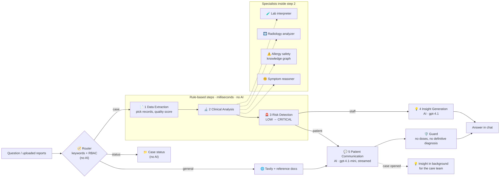
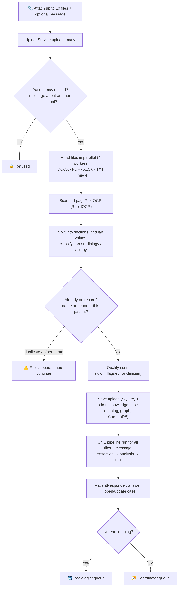
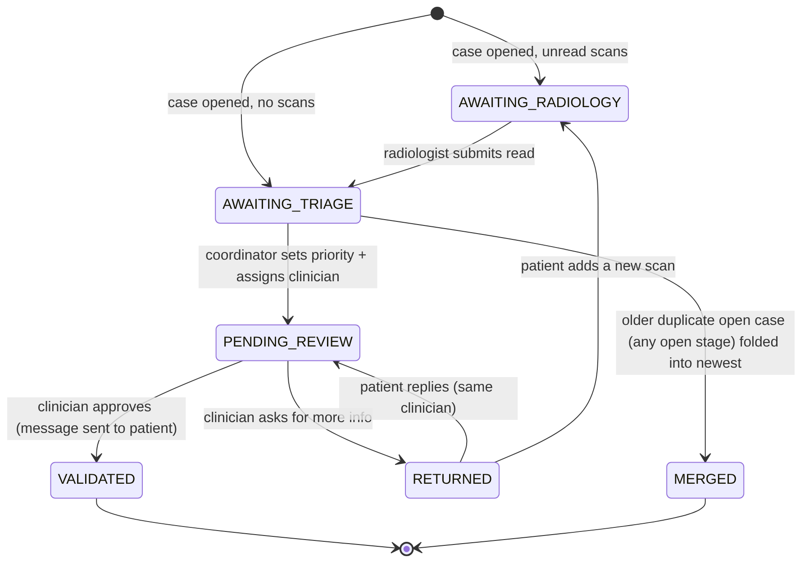

> **Generated**: 2026-11-16 04:21 UTC
> **Updated**: 2026-11-16 04:21 UTC
> **Project**: ClinicalChat — multi-agent clinical chatbot (HealthCare capstone)
> **Status**: Final

# How ClinicalChat works (in plain English)

No programming knowledge is needed for this page.

For the technical view, see [ARCHITECTURE.md](ARCHITECTURE.md). For the file-by-file view, see [FILE_GUIDE.md](FILE_GUIDE.md).

## Table of Contents
- [The big picture: a small clinic in software](#the-big-picture-a-small-clinic-in-software)
- [The five agents, one by one](#the-five-agents-one-by-one)
- [The tools the agents use](#the-tools-the-agents-use)
- [Three example journeys](#three-example-journeys)
- [Who does what in the care team](#who-does-what-in-the-care-team)
- [Why it is fast](#why-it-is-fast)
- [Why it is safe](#why-it-is-safe)
- [Revision History](#revision-history)

---

## The big picture: a small clinic in software

Think of ClinicalChat as a small clinic.

- 🧭 **The receptionist (the Router)** reads your message and decides where it goes. Is it:
  - "where is my case?";
  - a general health question ("what is HbA1c?");
  - something about **your** health ("I have fever and cough")?

  The receptionist also checks that you only see what you are allowed to see. A patient sees only their own record.
- 📄🔬🚨 **Three clerks follow fixed checklists.** They never guess and they never use AI, which makes them instant and predictable. They pull out your reports, check every value, and decide how urgent things are.
- 💡💬 **Two writers use AI (OpenAI).** One writes a clinical summary for doctors. The other writes a friendly explanation for you.
- 🛡️ **A safety officer (the Guard)** reads everything before a patient sees it. It removes medicine doses, definite diagnoses and "stop your medicine" advice.
- 👩‍⚕️ **The real care team** (radiologist, coordinator, clinician) reviews your case and sends you a confirmed message.

---

## The five agents, one by one

### 📄 1. Data Extraction: "the records clerk"
- **Job:** find the right papers in your file for this question. A kidney question needs kidney reports, not your X-ray.
- **How:** it looks up your documents (dataset and uploads), keeps only the kinds your role may see, and gives each one a **readability score** from 0 to 1. A blurry photo scores low and is flagged "a clinician should double-check".
- **Tools:** the document catalog and the quality scorer. No AI.

### 🔬 2. Clinical Analysis: "four specialists at one desk"
This agent runs four mini-experts on the papers the clerk found:
- 🧪 **Lab interpreter.** It compares each lab value with the normal range printed on that same report, for example "Hb 9.1, normal 12–16 → LOW". Then it looks for patterns: a low MCV or low ferritin suggests possible iron deficiency.
- 🩻 **Radiology analyser.** It reads imaging reports for red-flag words such as "haemorrhage" or "pneumothorax". It understands "no evidence of fracture", so that is **not** treated as a fracture.
- ⚠️ **Allergy safety.** It checks every medicine you mention or take against your allergies, using the **knowledge graph** (explained below). It knows, for example, that a penicillin allergy also matters for amoxicillin.
- 🤒 **Symptom reasoner.** It works out which conditions could explain your symptoms. It raises a **"Clinical Inconsistency"** when symptoms and reports disagree, for example "very tired" but a perfectly normal blood count.
- **Tools:** the knowledge graph and fixed medical rules. No AI.

### 🚨 3. Risk Detection: "the triage nurse"
- **Job:** decide how urgent it is: **LOW, MODERATE, HIGH or CRITICAL**.
- **How:** a list of clear rules, so every decision can be explained:
  - a critical lab value means CRITICAL;
  - chest pain means CRITICAL (possible heart attack);
  - a red flag on a brain CT means CRITICAL;
  - giving a medicine the patient is allergic to means HIGH.

  If the level is high enough, the case is **escalated** to a clinician, and the patient immediately sees "go to the emergency department" guidance.
- **Tools:** rules only. No AI.

### 💡 4. Insight Generation: "the senior doctor's summary" (AI)
- **Job:** read everything the three clerks found and write a short structured note for the care team. The note contains:
  - the answer and key findings;
  - possible conditions;
  - next steps;
  - a confidence level;
  - "Review Required" if something is missing or contradictory.
- **When:**
  - **Staff:** while they wait (about 3 seconds).
  - **Patients:** quietly in the background, saved onto the case, so the patient never waits for it. If nothing new has happened since last time, the previous note is reused and no AI is called.
- **Tools:** OpenAI **gpt-4.1**. The model also sees past clinician review notes, so it learns from feedback. With Tavily, staff can ask for "latest guidelines" and the note cites web sources as [W1], [W2].

### 💬 5. Patient Communication: "the friendly explainer" (AI)
- **Job:** explain things to the patient in simple words: what the reports show, what to watch for, what happens next.
- **How:** one AI call. The words appear as they are written (streaming). Every piece is checked by the 🛡️ Guard as it arrives.
- **Tools:** OpenAI **gpt-4.1-mini**, which is fast. For general questions it also uses trusted health websites via Tavily and a **FAQ memory**, so a repeated question is answered instantly.

---

## The tools the agents use

| Tool | What it is, in plain words | Who uses it |
|------|----------------------------|-------------|
| **Knowledge graph** (NetworkX) | A "mind map" of medical facts. Dots are things (drugs, allergies, symptoms, conditions, patients). Lines are relationships such as *amoxicillin* —is a→ *penicillin*, or *patient* —allergic to→ *penicillin*. Following the lines answers "is this medicine safe for this person?" without guessing. | Allergy safety, Symptom reasoner, Risk, Router |
| **Vector search** (ChromaDB + MiniLM) | A library index that finds passages by **meaning**. Searching "sugar levels" also finds "HbA1c" and "glucose". | Records clerk, general answers |
| **OCR** (RapidOCR) | Reads text from scanned PDFs and phone photos of reports. | Upload reader |
| **Report readers** | Open Word, PDF, Excel and text files, split them per patient and find lab tables with their normal ranges. | Upload, dataset ingestion |
| **OpenAI** | The language model that writes the two AI texts. Two sizes: strong (gpt-4.1) for doctors, fast (gpt-4.1-mini) for patients. | Agents 4 and 5 |
| **Tavily** | A web search limited to trusted medical sites (WHO, NHS, CDC, MedlinePlus, …). Names and IDs are removed from the question first. | General questions, staff guidelines, unknown medicine names |
| **SQLite database** | A single-file database holding log-ins, cases, uploads, review notes and caches. | All services |
| **Caches** | Short-term memory so the same work is not paid for twice: the AI-answer cache, the FAQ memory, the last insight per patient, and web results (kept 7 days). | AI agents, web search |
| **Guard** | A fixed list of "never say this to a patient" rules. | Every patient-facing text |
| **Audit log + Langfuse** | A diary of who asked what, which agents ran and how long each took. Langfuse shows it as a timeline in a dashboard. | Every question and action |

---

## Three example journeys

### A. "What is HbA1c?" (a general question)
1. The receptionist sees a general question with no personal data.
2. If it was asked before, the answer comes **instantly** from the FAQ memory.
3. Otherwise:
   - trusted websites and the reference material are checked;
   - 💬 writes a simple answer with links;
   - the guard checks it.
4. **No case is created.** It is just a question.

### B. "I have fever and cough since 3 days" (about your own health)
1. The receptionist sees personal symptoms, and they are saved to your record.
2. 📄 → 🔬 → 🚨 run in milliseconds. If anything is urgent, you see safety advice right away.
3. 💬 explains what this could mean and what to watch for, with the words appearing live.
4. Because there is something new, **one case is opened**, or your existing open case is updated, and sent to the care team.
5. 💡 writes the doctor's note in the background.

### C. Uploading a report
1. Attach up to 10 files. Each one is read (with OCR for scans) and checked:
   - if the report carries **another person's name**, it is refused;
   - if it is already on your record, it is skipped.
2. All new reports go through the agents **together**, giving one answer.
3. The case goes to the **radiologist** first if it contains scans, otherwise straight to the **coordinator**.

---

## Who does what in the care team

| Person | Log-in | Role in the story |
|--------|--------|-------------------|
| 🧑 Patient | ananya.rao, rahul.mehta, riya.das, or a new sign-up | Asks questions, uploads reports, receives the clinician's confirmed message in the chat. |
| 🩻 Radiologist | dr.iyer | Sees only cases with **unread scans**. Writes the radiology read. Sees allergies only to check contrast-dye safety. |
| 🧭 Care coordinator | coord.thomas | Sees every new case on a board. Sets the **priority** and **assigns a clinician**. |
| 👩‍⚕️ Clinician | dr.sharma, dr.menon | Sees only cases **assigned to them**: the AI note, the radiology read and the draft message. Can **approve** (optionally editing the message) or **return** the case asking for more information. |

The demo password for all built-in log-ins is shown on the log-in page.

---

## Why it is fast

- Agents 1–3 use no AI, so they finish in **milliseconds**.
- A patient question uses **one** AI call, and the words stream in. The first words arrive in about 1–2 seconds.
- The doctor's note (💡) is written **in the background** for patients.
- Anything already answered is reused from memory: the FAQ memory, the previous insight, cached web results and the AI-answer cache.
- "Where is my case?" is answered straight from the case record, with no AI at all.

## Why it is safe

- Medicine and allergy checks are **rules**, not AI guesses, and run before the AI is involved.
- The 🛡️ Guard checks **every** sentence a patient sees.
- Emergencies are never delayed: urgent advice is shown immediately.
- The care team's message on a case reaches the patient **only after a clinician approves it**.
- Patients can only see their own data. Web searches never include names or IDs.
- Everything is written to the audit log.

---

## Revision History

| Version | Date | Author | Changes |
|---------|------|--------|---------|
| v1.0 | 2026-11-16 | Copilot | Initial version after the SOLID / layered refactor |
